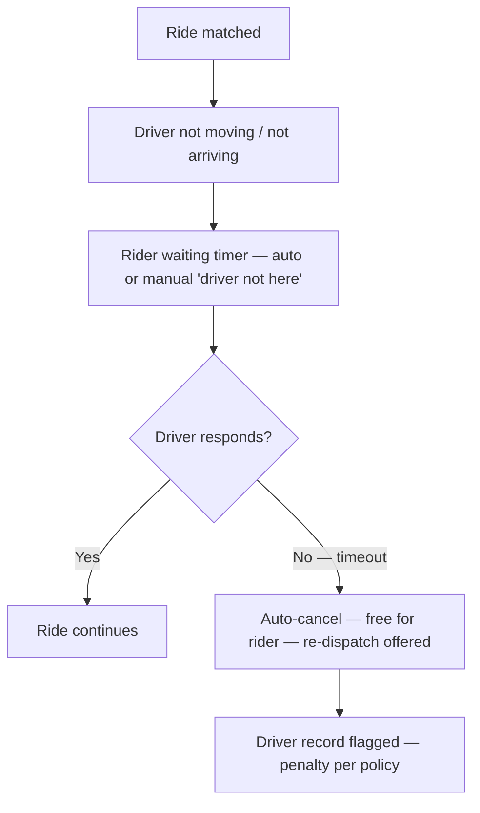

# USER-FLOWS.md — UX Audit & Corrections
**Audited:** USER-FLOWS.md (F-01 → F-32), against Ride_App_UIUX_Rethink_3_Master_Plan.md v3.0 + Plan 27 scope.
**Severity:** 🔴 HIGH (functional gap / dispute risk) · 🟡 MED (consistency / clarity) · 🟢 LOW (polish)
**Owner contract:** Plan 27 wins over diagrams where they conflict. These corrections amend the flows, not the plan's business rules.

---

## 1. Critical gaps — fix first

### 🔴 G1 — Driver no-show flow missing (inverse of F-06)
F-06 defines *rider* no-show. The inverse (driver matched but never arrives / never starts) has no flow. Rider is left waiting with no exit.

**Correction:** Add to F-06:


### 🔴 G2 — In-ride extra-charge approval step missing from F-05
F-05 shows the fare breakdown only *after* finish. But tolls/parking/waiting charges (`ExtraChargeApproval.tsx` exists in the codebase) must be approved by the rider **during** the ride, or every cash collection becomes a dispute.

**Correction:** Insert into F-05 between START and Finish:
```
Driver requests extra charge (toll/parking/waiting)
→ Rider sees push + in-ride card: amount + reason → Approve / Decline
→ Approved → ledger entry (items in paisa)
→ Declined → driver may still record it, flagged for admin review
→ Final breakdown shows each approved line with "approved in-ride" tag
```

### 🔴 G3 — Pending-verification intermediate state undefined
F-01 ends at "Pending — admin verifies". The *applicant's* app has no defined screen between submission and decision. Plan 17 (manual admin activation) means waits can be hours/days.

**Correction:** Add a universal `VerificationPendingScreen`:
- Status tracker: `Submitted → Docs received → Under review → Decision`
- Timestamp of submission, expected review window (e.g., "within 24h")
- Rejection = structured: failed field highlighted + example of acceptable document + one-tap "Fix & resubmit" prefilled with prior answers (never make the user redo the whole wizard)

### 🔴 G4 — Parcel fee tiers have no parcel attributes
F-11/F-14 collect ৳80/120 purely by distance. Nothing captures weight/size/fragility, so the fee quoted at booking may not match what the courier expects at pickup — a COD argument waiting to happen.

**Correction:** At booking, add a 3-choice parcel class: `Small (≤5kg) → ৳80 · Large/heavy (>5kg) → ৳120 · Fragile → ৳120 + handle-with-care flag`. Class stored on the order; courier sees it in the offer.

---

## 2. Per-flow corrections

### A. Auth, Roles & Onboarding (F-01–F-03)

| # | Sev | Flow | Issue | Correction |
|---|-----|------|-------|------------|
| A1 | 🟡 | F-01 | 5 role buttons on the welcome screen is heavy for a first-run user | Show Customer + "Earn with us" grouping (Driver / Delivery / Shop / Fleet behind one expander). Progressive disclosure. |
| A2 | 🟡 | F-01 | OTP failure path undefined (SMS delays are common in BD) | Add resend cooldown (30s) + voice-call OTP fallback + "change number" escape hatch. |
| A3 | 🔴 | F-01 | No suspended/blocked/deleted account state | Add to the state machine: admin can later suspend any role → user sees a locked screen with reason + support contact. |
| A4 | 🟡 | F-02 | Multi-role users re-pick every login | Remember last-used role; preselect it on the "Login as" screen (one tap to switch). |
| A5 | 🟡 | F-02 | Staff sessions indistinguishable from owner sessions | Persistent banner: "Acting as staff · [Shop name]". Staff UI hides owner-only actions (payouts, staff invites, settlement) — server-enforced, but UI must not render them. |
| A6 | 🟢 | F-03 | Rejection reason is free text | Structure it: reason code + failed field + example. Free text as optional addendum only. |

### B. Ride-hailing (F-04–F-08)

| # | Sev | Flow | Issue | Correction |
|---|-----|------|-------|------------|
| B1 | 🔴 | F-04 | Cancellation window exists but is invisible to the rider | Active-ride card shows a countdown chip ("Free cancel for 2:14 more"). Cancel dialog shows the exact fee amount before confirming. |
| B2 | 🔴 | F-04 | No-drivers state dead-ends the user | Add: auto-retry with backoff (3 attempts), "Notify me when drivers are nearby", and one-tap re-book of the last search. |
| B3 | 🟡 | F-04 | Active-ride screen contents not specified in the flow | Standard card nodes: driver photo/name/plate, vehicle type, ETA, masked call, in-app chat (F-08), share-trip, trip PIN display. Name the route: `app/(rider)/ride/active/[rideId].tsx`. |
| B4 | 🔴 | F-05 | Post-ride breakdown can diverge from quote with no explanation | Every deviation line renders its cause: `+৳40 toll (approved in-ride) · +৳25 detour +3km`. No silent deltas at COD collection. |
| B5 | 🟡 | F-06 | Driver cancel → re-dispatch, but rider has no agency | Add rider toggle "auto-accept next match" and a one-tap "why was my ride cancelled?" micro-survey feeding driver ranking. |
| B6 | 🟡 | F-07 | Scheduled ride at window: does it auto-enter dispatch? | State explicitly: enters F-04 automatically at window start (no re-confirm). Send reminder push T-30min + T-5min. |
| B7 | 🟢 | F-08 | Chat has no offline affordance | Thread shows "connecting…" state; messages queue and display "sent when online". |

### C. Trust, Safety & Support (F-09–F-10)

| # | Sev | Flow | Issue | Correction |
|---|-----|------|-------|------------|
| C1 | 🔴 | F-09 | "No cooldown, every trigger = new alert" is a backend rule, but UI needs anti-accident protection | Hold-to-trigger (~1.5s) + explicit confirm sheet. Backend keeps no-cooldown; UI debounces. |
| C2 | 🟡 | F-09 | After trigger, user gets no feedback on what happens next | Post-trigger screen: alert ID, "Location shared with dispatch", buttons: call 999, share live location with emergency contacts, cancel alert (if accidental). |
| C3 | 🟡 | F-09 | SOS banner on counterparty app — ambiguous who sees it | Define: rider SOS → driver's app shows banner; driver SOS → rider sees "your driver has triggered an emergency — you may exit safely". |
| C4 | 🟡 | F-10 | No reporting deadline; disputes after cash handover are hard | Ride detail shows "Report an issue — available for 24h after ride". Lost-item flow adds masked direct call to driver before filing an admin case. |

### D. Marketplace (F-11–F-16)

| # | Sev | Flow | Issue | Correction |
|---|-----|------|-------|------------|
| D1 | 🔴 | F-11 | Courier offer timeout & re-offer cap unspecified | Specify: 45s offer window, sequential max 3 suggestions, then F-12. Put the numbers in `platform_config`, not code. |
| D2 | 🔴 | F-11 | No pickup verification — wrong-item claims impossible to adjudicate | Handover uses a 4-digit pickup code: shop shows code, courier enters it (or vice versa) → "Picked up" entry only valid with matching code. |
| D3 | 🟡 | F-11 | COD collection has no change-shortage path | Courier flow: enter amount received → if < fee, record shortfall ("customer short ৳20") → settlement line shows it; prevents "he never paid" disputes. |
| D4 | 🟡 | F-12 | COD cancel has no refund concept, but customer copy is undefined | Notify with reason; ledger reversal only reverses the *shop's* settlement credit — no money moved. Say so in the customer message. |
| D5 | 🟡 | F-13 | Workshop request has no response SLA | Auto-decline after 2h; customer sees "Shop didn't respond — pick another slot or cancel". |
| D6 | 🔴 | F-14 | Receiver-pays cash without receiver verification | Receiver phone entered at booking; courier sees receiver name + phone; delivery completes only after receiver code entry. Add sender-pays option (sender hands fee to courier at pickup). |
| D7 | 🔴 | F-15 | No attempted-delivery / failed-delivery flow | States: arrived → call receiver → wait 5 min → "receiver absent" → return-to-shop or second attempt → delivery proof = receiver code OR photo at door. |
| D8 | 🟡 | F-16 | Accept order has no prep-time input; courier ETA is fiction | At accept, shop picks prep time (10/20/30 min) → dispatch starts offering couriers at `ready_time - travel_time`. |
| D9 | 🟢 | F-16 | Only Open/Closed binary | Add "Busy" mode: keeps shop open but throttles new orders (e.g., accept one at a time). |

### E. Fleet (F-17–F-19)

| # | Sev | Flow | Issue | Correction |
|---|-----|------|-------|------------|
| E1 | 🔴 | F-19 | Ambulance has no acknowledgement SLA while rental (F-18) has 5-min SLA — inconsistent | Ambulance: accept = immediate ack with en-route ETA. If no fleet accepts in 60s, escalate: expand radius, notify customer of delay, offer alternate fleets. |
| E2 | 🔴 | F-19 | No continuous location sharing for emergency | Ambulance requester sees live vehicle position from accept → complete (not just status entries). |
| E3 | 🟡 | F-18 | "Demoted" wording is admin jargon | Customer-facing copy: "That fleet didn't respond in time — please confirm another bid." |
| E4 | 🟢 | F-17 | Vehicle ↔ driver assignment has no unassign/return state | Add: return vehicle → vehicle returns to fleet pool → assignable again. |

### F. Driver lifecycle (F-20–F-25)

| # | Sev | Flow | Issue | Correction |
|---|-----|------|-------|------------|
| F1 | 🟡 | F-20 | launch_free comped plan shown like a purchasable plan | Show grant source: "Free launch access · expires [date] · renews at ৳100/mo when payments open." Prevents "is this broken?" support tickets. |
| F2 | 🔴 | F-21 | Dues repay channel undefined at COD launch | "Repay" CTA must name a real channel: office cash / bKash agent / auto-deduct from future earnings credit. Never show a balance with no action path. |
| F3 | 🟡 | F-22 | Min-rate dispatch filter — rider sees nothing if filtered out | If min-rate filters a driver from a request, rider side must not count that as "no drivers online" — dispatch reports `matching_but_filtered` separately so product can tune. |
| F4 | 🟢 | F-24 | Break mode: does it pause delivery offers too? | State it: break pauses ride offers; delivery offers controlled by the Deliveries toggle independently (F-15). |

### G. Customer money & growth (F-26–F-29)

| # | Sev | Flow | Issue | Correction |
|---|-----|------|-------|------------|
| G1 | 🟡 | F-26 | Descoped features hidden entirely | Render Wallet top-up / pass purchase as disabled rows: "Coming soon — cash accepted now." Users should learn the feature exists. |
| G2 | 🟢 | F-27 | Promo ineligibility reason | Ineligibility message must name the failing criterion (vehicle type, zone, time), not generic "not applicable". |
| G3 | 🟡 | F-29 | Notification hub has no mute controls | Settings → per-category mute (rides / orders / promos / SOS). Promos off by default for new users. |

### H. Admin (F-30–F-32)

| # | Sev | Flow | Issue | Correction |
|---|-----|------|-------|------------|
| H1 | 🟡 | F-32 | Fare config PATCH takes effect immediately with no notice | Config change → broadcast notice ("Night multiplier changed, effective now") to affected in-flight sessions and next estimate screen. Silent fare changes cause COD disputes. |
| H2 | 🟢 | F-31 | Force-cancel has no customer-facing reason field | Require reason code; customer notification carries it. |

---

## 3. Cross-cutting corrections (apply to all diagrams)

1. **Offline branch on every write-flow.** Master Plan §2.1 (BD constraints) demands it. Rule: any screen that creates state shows a queued indicator ("will send when online"): chat, order placement, rating, SOS, extra-charge approval.
2. **Standardize the 8 shared states** in one legend — `pending / active / in-progress / completed / cancelled / disputed / refunded / archived` — and reuse. F-11 through F-16 invent their own wording per diagram.
3. **Empty states designed, not blank.** None specified: no shops open, no offers today, no settlements this week, no notifications yet. Each list screen gets an empty-state node in its flow.
4. **Degraded dispatch lane.** Dispatch engine unreachable → requests queue as "searching (slow network)" with a cancel path — never a raw error screen.
5. **Flow ↔ code mapping.** Each diagram node annotates its route/screen (e.g., `app/(rider)/ride/active/[rideId].tsx`) so the coding agent wires nodes to files. Currently only backend tables are referenced.
6. **Language switch is a flow, not a setting.** BD app must note that every screen renders Bangla/English from a shared copy table; flows shouldn't branch on language.

---

## 4. Priority order for implementation

| Wave | Items |
|------|-------|
| **W1 — Dispute & safety blockers** | G1, G2, D1, D2, D6, D7, E1, F2, C1 |
| **W2 — Trust & consistency** | B1, B2, B4, D3, D8, A3, H1 |
| **W3 — Clarity & polish** | everything MED/LOW above |
