# Ride — User Flows & Workflows (Mermaid) — FULL LIBRARY v2

**Purpose:**     Visual source of truth for EVERY user flow and workflow across all personas (Customer, Driver, Shop Owner + staff, Fleet Owner + dispatcher, Delivery Man, Admin web panel) — implements `docs/Plan/27-SHOP-FLEET-STAFF-DELIVERY-SURFACES-PLAN.md` (§0 rulings, §11 corrections, §12 settlement, §14 subscriptions) **plus §15.1 (Kimi UX audit — accepted in full, waves W1–W3)**. Rendered copy: `USER-FLOWS.html` (regenerate: `node docs/FeatureList/build-user-flows-html.cjs`).
**Owner:**       Orchestrator (the plan is the contract) — Coding model keeps diagrams in sync with shipped screens.
**Status:**      ACTIVE v2 (2026-10-12 — all six reviews consolidated; §15 C rejections and D deferrals apply here too)
**Source of truth:** `docs/Plan/27-SHOP-FLEET-STAFF-DELIVERY-SURFACES-PLAN.md` — discrepancies = plan wins, fix the diagram.
**Related (concrete paths):** `maestro/COVERAGE-MANIFEST.md`, `docs/FeatureList/FEATURES.md`, `docs/FeatureList/USER-FLOWS-AUDIT-2026-10-12.md` (Kimi audit, accepted in full), `AGENTS.md` § Orchestrator Protocol.
**Last verified:** 2026-10-12, by Orchestrator.
**How to update:** a flow change ships with its diagram change in the same commit; regenerate the HTML with the build script; keep the status badges truthful.

## LEGEND & CONVENTIONS (binding for every diagram)

- **Launch state badges** in every title: ✅ live · 🔨 in development (Plan 27) · 💤 descoped (owner ruling).
- **Roles taxonomy:** 5 registrable roles (Customer, Driver, Shop Owner, Fleet Owner, Delivery Man) · 2 invited sub-roles (Shop Staff — orders-only; Fleet Dispatcher — no payouts) · internal Admin (web only). Sub-roles never appear as signup buttons; they arrive via invite (F-34).
- **Courier** = a Delivery Man, or a Driver with the Deliveries toggle ON.
- **Identity:** phone = login identity · internal User ID = system key for everything else.
- **State vocabulary (shared):** pending / active / in-progress / completed / cancelled / disputed / refunded / archived.
- **`[notify]` convention:** every "notify" edge means the F-29 notification spec applies (channel, batching class, locale).
- **Grammar rule:** sequenceDiagram for money-handshake sequences (F-05, F-11, F-18, F-33); flowchart for state/branching (F-04 dispatch branching stays a flowchart).
- **Offline convention:** any screen that creates state shows a queued indicator ("will send when online") — chat, orders, ratings, SOS, extra-charge approvals.
- **Money:** integer paisa; COD at launch (payments 💤); every rate is a platform_config LAUNCH DEFAULT — fresh-read at request time, admin-editable, never hardcoded.
- **Launch wallet = platform CREDIT only** (refunds / referral / promos) — non-withdrawable; cash moves hand-to-hand at launch. Refunds at launch = credit or ledger reversal, never a gateway refund.
- **Flow ↔ code mapping:** screens annotate their route files where known (e.g., `app/(main)/(customer)/ride-tracking/...`).
- **Empty states are designed** (no shops open, no offers today, no settlements this week) — never blank lists. Degraded dispatch: requests queue as "searching (slow network)" with a cancel path.
- **Language:** every screen renders Bangla/English from the shared copy table — flows never branch on language.
- **Flow ↔ code mapping:** screens annotate their route files where known.

---

## A. AUTH, ROLES & ONBOARDING

### F-01 · 🔨 Registration & role onboarding (5 roles) — progressive disclosure

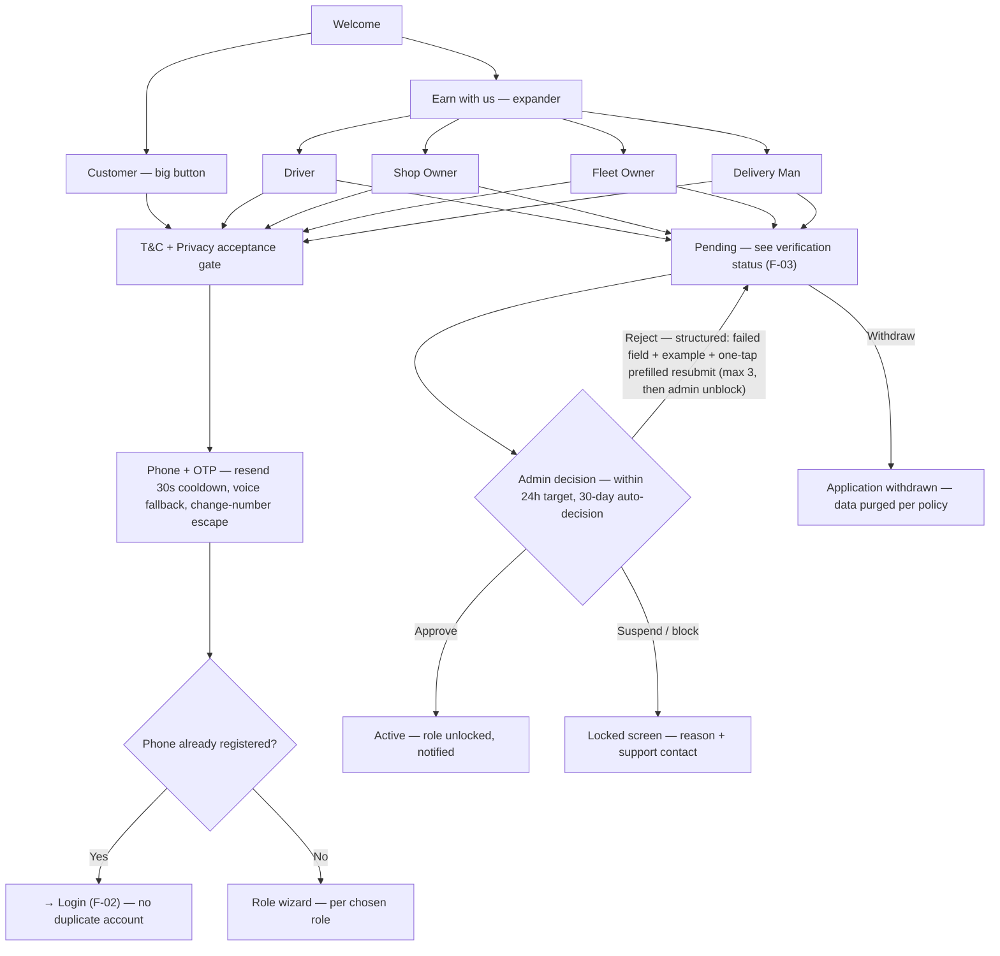

### F-02 · 🔨 Login & multi-role "Login as" chooser

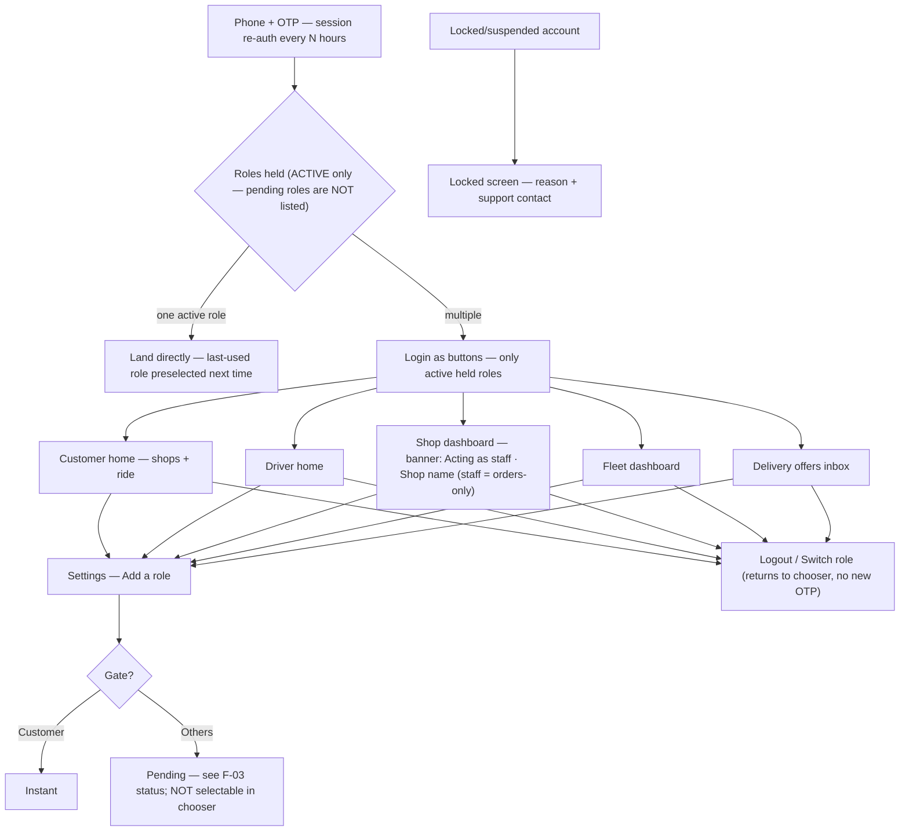

### F-03 · 🔨 My verification status (applicant side — canonical; admin side = F-30)

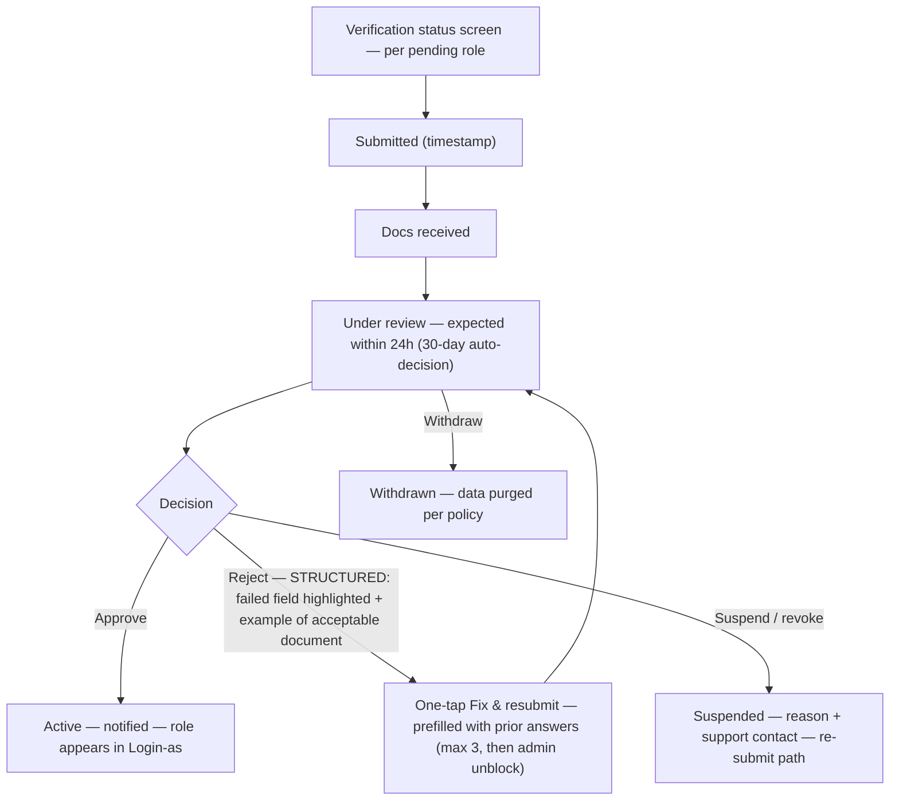

## B. RIDE-HAILING (V1)

### F-04 · 🔨 Customer ride booking → dispatch → match (sequence)

```mermaid
sequenceDiagram
  participant U as Rider
  participant APP as App
  participant GEO as Barikoi
  participant SYS as Dispatch
  participant D as Driver
  U->>APP: Pickup (GPS — fail → pick on map) + destination
  APP->>GEO: Geocode
  GEO-->>APP: fail → rider picks manually on map
  U->>APP: Select vehicle type + Apply promo (F-27)
  APP->>U: Stage-aware fare estimate (config snapshot — R-A9)
  U->>APP: Confirm — cancel-window chip visible with exact fee
  APP->>SYS: Ride requested — rider may cancel (fee per window; cancel edge from here)
  SYS->>SYS: matching_but_filtered reported separately (product telemetry)
  Note over U,D: Matched → driver en route (arriving state, ETA live) → continue at F-05
  alt drivers online
    loop sequential offers — 45s window, max suggestions (config)
      SYS->>D: Offer (min-rate filter respected; filtered counts reported, never shown as "no drivers")
      D->>SYS: Accept → debit-on-offer (PROVISIONAL — reversal rules F-06) → matched
      SYS->>U: Matched — active-ride card: driver photo/name/plate, ETA, masked call, chat, share-trip, PIN
    end
  else no drivers
    SYS->>APP: No-drivers — auto-retry with backoff (3) + "notify me" + one-tap re-book
  end
  SYS-->>SYS: offer budget exhausted → rider informed: keep waiting (radius expands) or free-cancel
```

### F-05 · 🔨 Ride lifecycle — start → finish → cash (sequence)

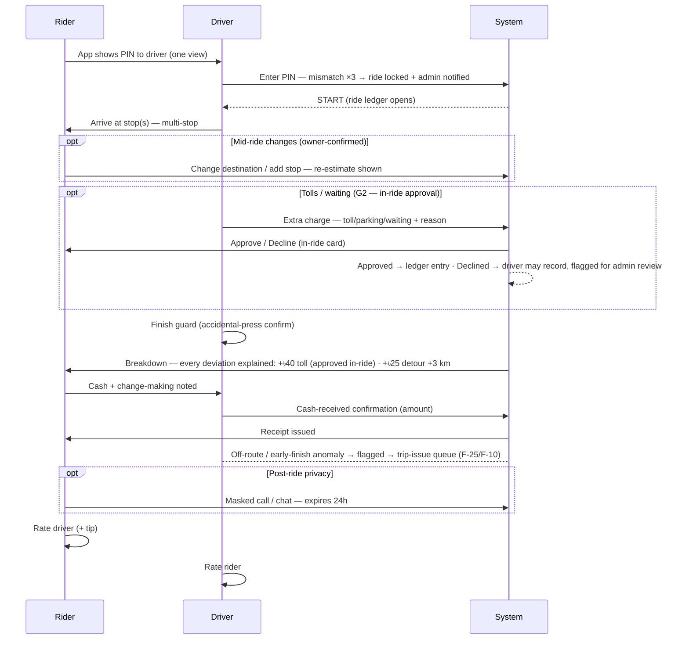

### F-06 · 🔨 Cancellation, no-show & driver-no-show (CANONICAL — both sides; F-25 merged here)

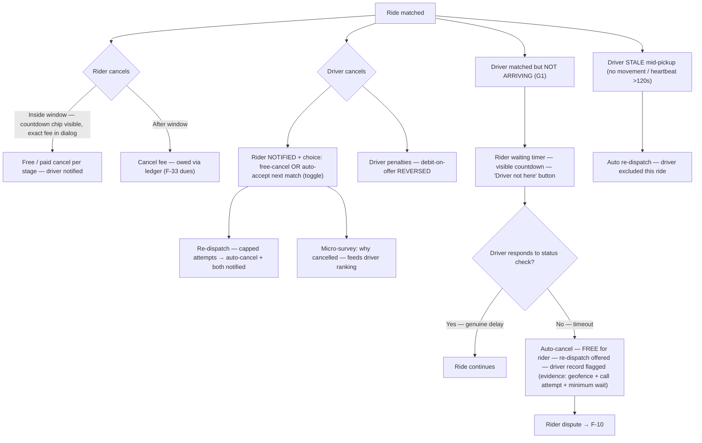

### F-07 · 🔨 Scheduled ride & book-for-other

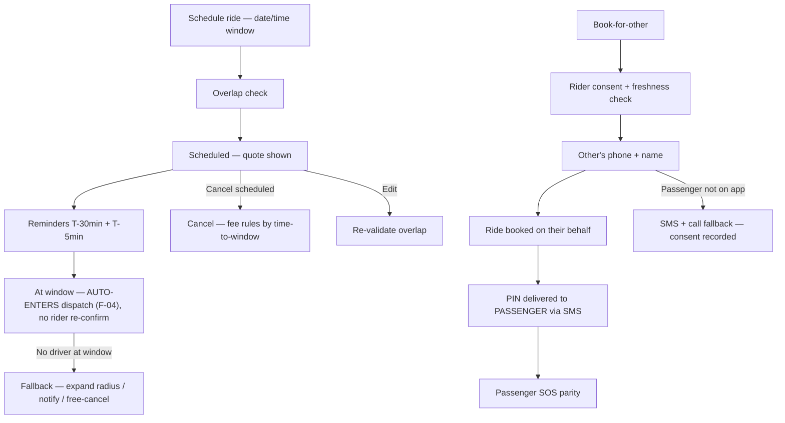

### F-08 · 🔨 In-ride chat (rider ↔ driver)

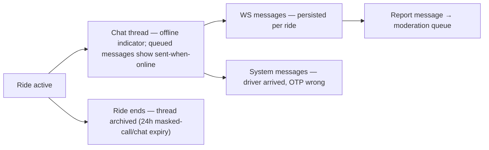

## C. TRUST, SAFETY & SUPPORT

### F-09 · 🔨 Emergency SOS (customer + driver) — with responder chain

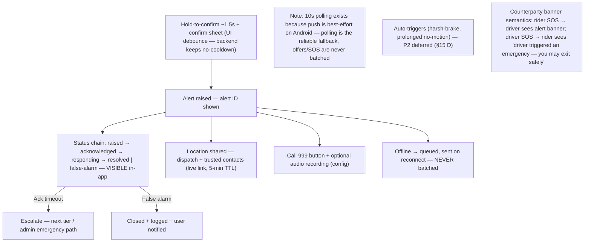

### F-10 · 🔨 Dispute / report issue / lost item

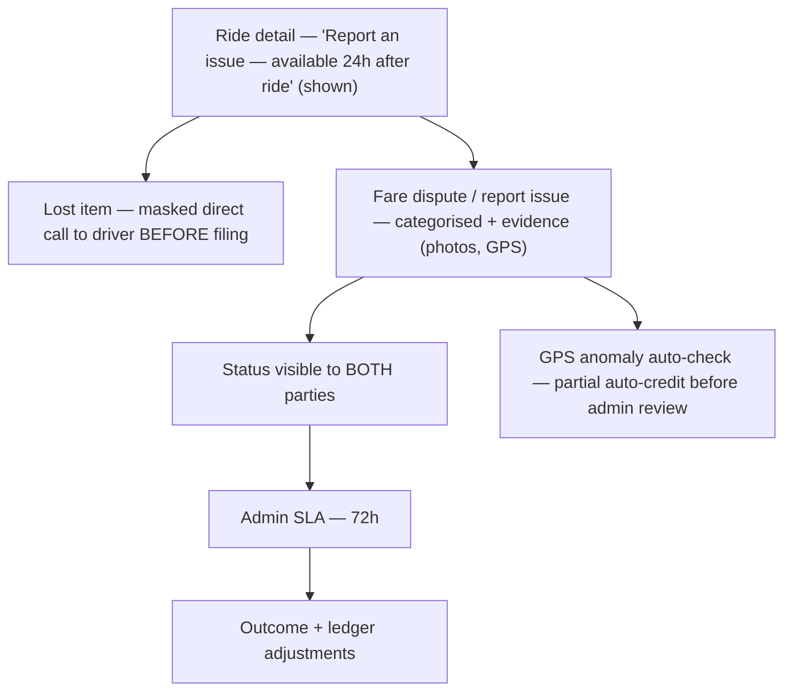

## D. MARKETPLACE — SHOPS, FOOD, WORKSHOPS, DELIVERY (Plan 27 🔨)

### F-11 · 🔨 Shop order → delivery dispatch (ALL categories — the canonical sequence)

```mermaid
sequenceDiagram
  participant U as Customer
  participant S as Shop (owner / staff)
  participant SYS as Dispatch system
  participant C as Courier (Delivery Man / Driver)
  U->>SYS: Place order — items + parcel class + COD total (offline → queued)
  SYS->>S: New order (shop closed → REJECTED server-side; response timeout → auto-reject + customer notified with reason)
  opt out of stock after accept
    S->>SYS: Partial — confirm missing items with customer (split or cancel)
  end
  opt customer edits before pickup
    U->>SYS: Address change / cancel — state-dependent fee
  end
  Note over U,S: customer ↔ shop chat — P2 deferred (§15 D)
  alt shop rejects — reason to customer
    S->>SYS: Reject (out of stock / closed early)
    SYS->>U: Order rejected + reason — nothing charged
  else shop accepts
    S->>SYS: Accept + prep-time picker (10/20/30 min)
    S->>SYS: Confirm assignment → preparing (dispatch starts at ready_time − travel_time)
    SYS->>SYS: Rank couriers — nearest → rating → subscription active (delivery men + drivers with toggle)
    loop sequential offers — 45s window × max 3 (platform_config)
      SYS->>C: Offer — shop, pickup, contact number, dropoff, ORDER VALUE, fee, parcel class
      C->>SYS: Accept (single-claim) / Reject / timeout
    end
    SYS->>S: Courier assigned — notified
    SYS->>U: Courier assigned — notified + ORDER TRACKING VIEW
    S->>S: Preparing → ready
    S->>C: Handover — 4-digit pickup CODE (shop shows, courier enters)
    C->>SYS: "Picked up" — valid only with matching code (liability shifts to courier)
    SYS->>S: Picked-up notification
    SYS->>U: Picked-up notification
    alt delivered
      C->>U: Deliver — collect items + fee (COD)
      C->>SYS: "Delivered" + AMOUNT COLLECTED (short-pay recorded → F-38)
      SYS->>S: Settlement credit — items (0% commission)
      SYS->>C: Earnings — fee (100%)
      SYS->>U: Receipt
    else failed / refused
      C->>SYS: Delivery failed + reason (receiver absent → call → wait → attempted)
      SYS->>S: Item returned → retry or self-deliver (F-12)
      SYS->>U: Notified — retry or cancel
    end
  end
  U->>SYS: Customer cancel — pre-pickup only, state-dependent fee (post-pickup: refuse-at-door → F-14 return path)
  U->>SYS: Dispute (wrong/missing item) → F-38
```

### F-12 · 🔨 Delivery exhaustion — retry, bump, self-deliver, cancel

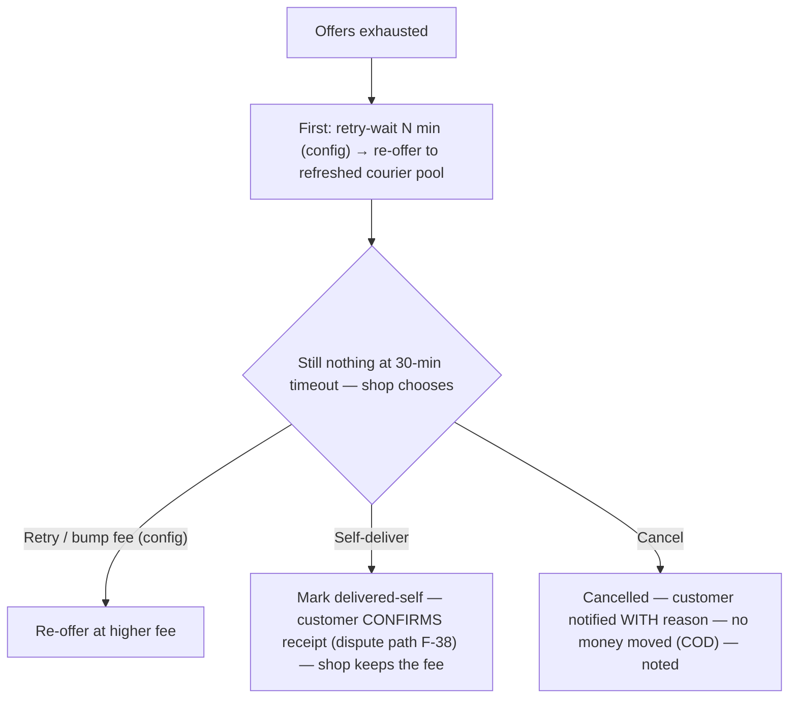

### F-13 · 🔨 Workshop — products AND services (split lanes)

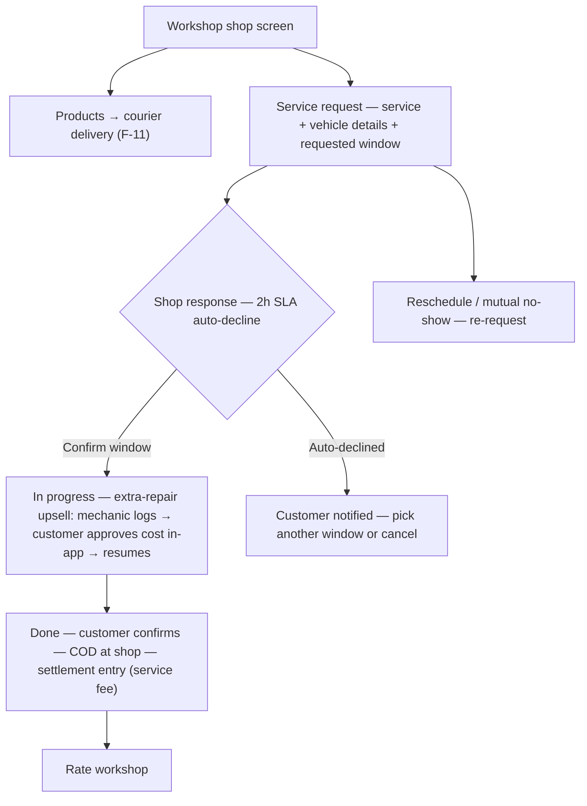

### F-14 · 🔨 P2P delivery (any role originates)

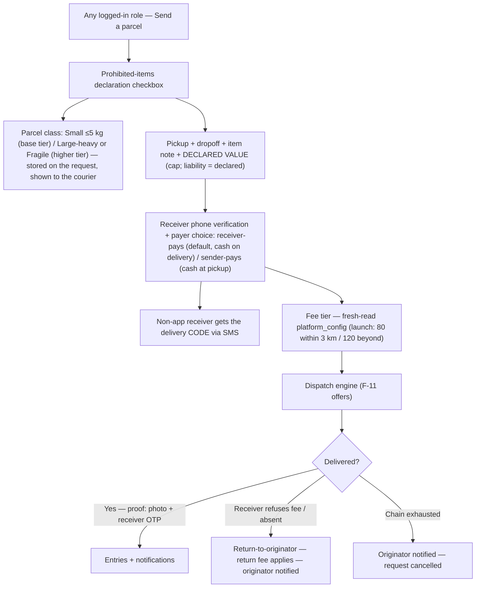

### F-15 · 🔨 Delivery Man day (and Driver with Deliveries toggle ON)

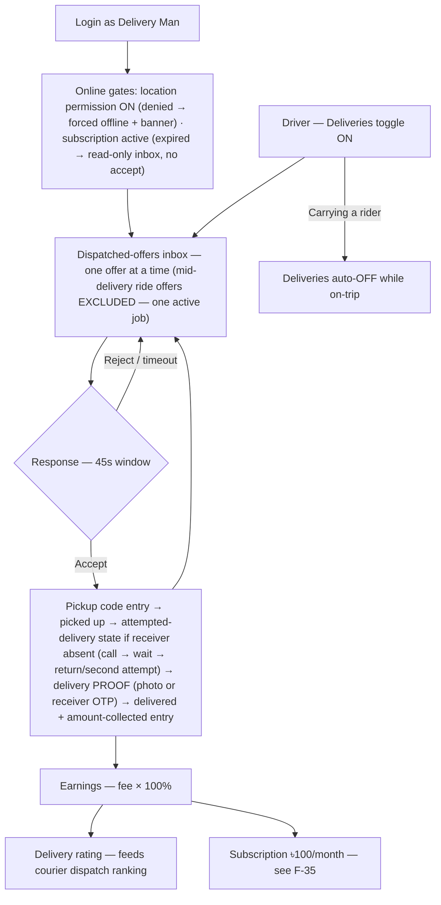

### F-16 · 🔨 Shop Owner / Staff day (SPLIT views — staff is orders-only)

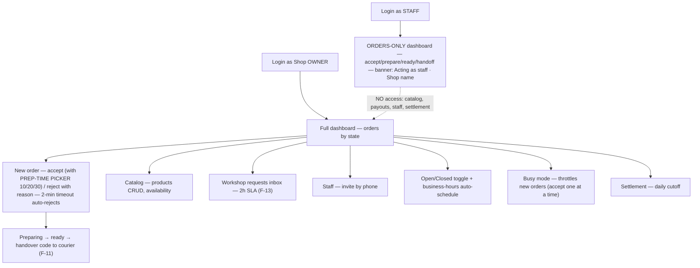

## E. FLEET (RENTAL + AMBULANCE) & OWNER/DISPATCHER

### F-17 · 🔨 Fleet Owner — onboarding → dashboard

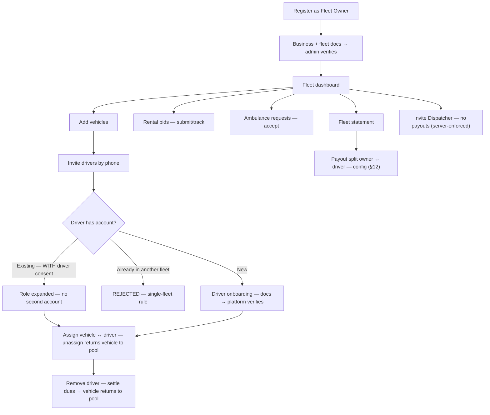

### F-18 · 🔨 Car rental — request → broadcast → bid → award → lifecycle (V2)

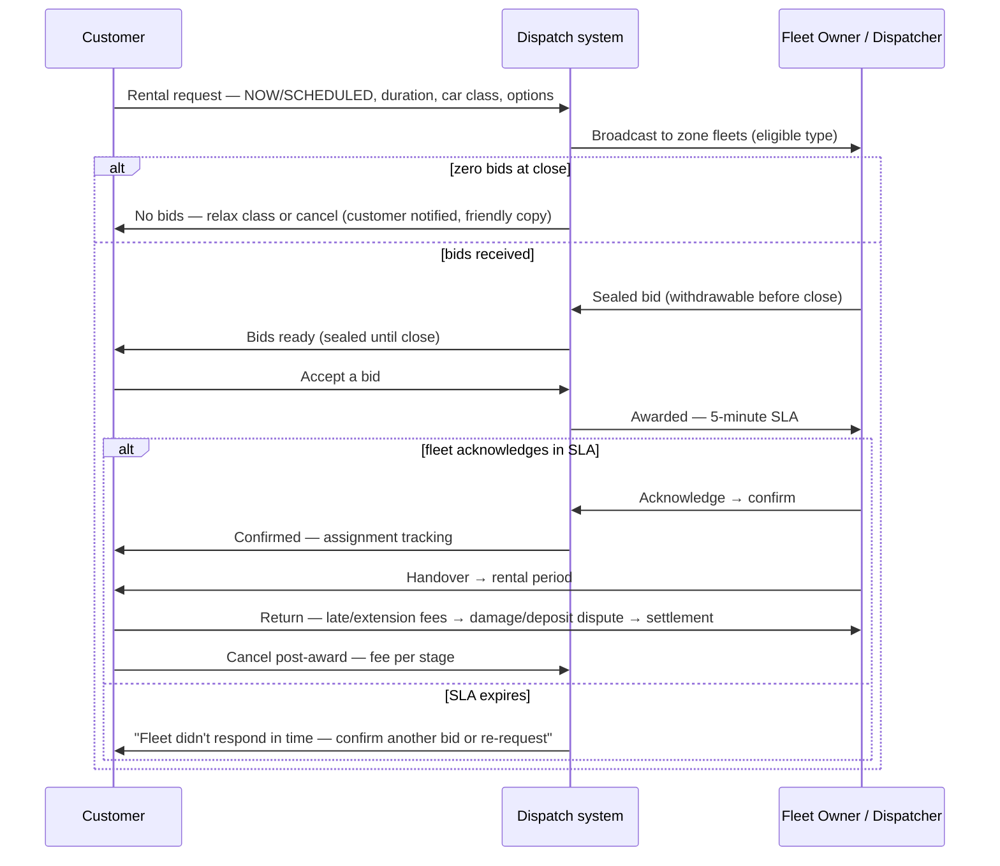

### F-19 · 🔨 Ambulance — emergency request (V7)

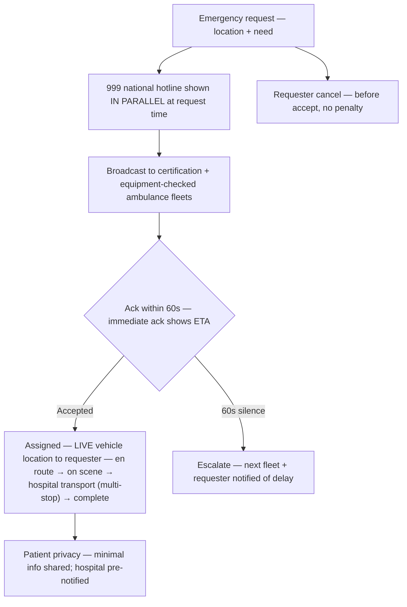

## F. DRIVER LIFECYCLE

### F-20 · 🔨 Driver subscription (packages) — role-filtered, grant-source shown

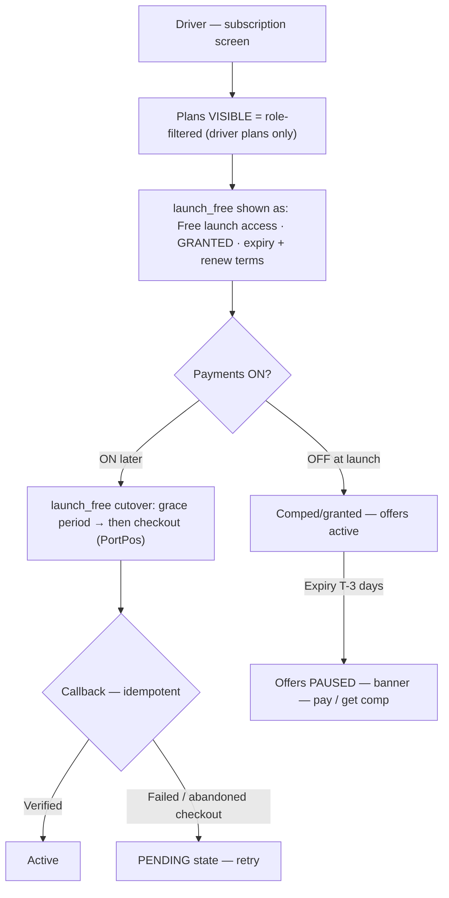

### F-21 · 🔨 Driver earnings, dues & payouts — repay channels NAMED

```mermaid
flowchart TD
  A["Earnings — rides + delivery legs (source-tagged)"] --> B["Breakdown per ride/leg"]
  A --> C["Due amounts — commissions owed (debit-on-offer)"]
  C --> D{"Repay — NAMED CHANNELS: office cash / bKash agent / auto-deduct from earnings credit"}
  D --> E["Overdue > threshold → reminders → DISPATCH HOLD"]
  A --> F["Commission statement — export CSV/PDF"]
  A --> G["Disputed earning → admin queue (F-10 path)"]
```

### F-22 · 🔨 Driver vehicle management & min-rate

```mermaid
flowchart TD
  A["Vehicle management — my vehicles"] --> B["Add / edit vehicle (type enum, docs)"]
  B --> C{"Docs expiring / expired?"}
  C -->|"Expiring T days"| D["Warning banner"]
  C -->|"Expired"| E["Offers BLOCKED — banner — re-submit docs"]
  B --> F["Vehicle-type change — request → admin queue (F-30) — approve/reject"]
  A --> G["Min-rate — bounded by platform floor"]
```

### F-23 · 🔨 Driver performance, hotspots, promos, referral

```mermaid
flowchart TD
  A["Performance stats — acceptance, completion, ratings"] --> B["LOW RATING over N weeks → dispatch DE-PRIORITIZED (shown to driver)"]
  A --> C["Hotspot map — aggregated zone-level (opt-in view)"]
  A --> D["Driver promos — applicable campaigns"]
  A --> E["Referral — anti-fraud: device + bank + IP dedupe; reward REVERSED on refunded ride"]
```

### F-24 · 🔨 Break mode, safety center, support

```mermaid
flowchart TD
  A["Break mode — pauses BOTH ride and delivery offers"] --> B["Auto-end after X hours (config)"] --> C["Resume — presence restored"]
  D["Safety center — emergency contacts (multiple)"] --> E["SOS (F-09)"]
  F["Support — FAQ + ticket with SLA + status"]
```

### F-25 · ⊘ MERGED into F-06 (driver-side no-show view). See F-06.

## G. CUSTOMER MONEY & GROWTH

### F-26 · 💤 Wallet top-up & rider passes (descoped — VISIBLE but disabled)

```mermaid
flowchart TD
  A["Wallet / passes entry"] --> B["Rendered as DISABLED rows: Coming soon — cash accepted now"]
  B --> C["Pass usage (granted via admin/promo — no purchase rail at launch)"]
  B -->|"When payments ON"| D["PortPos checkout → callback verifies → wallet/pass credited"]
```

### F-27 · 🔨 Apply promos (ride discounts)

```mermaid
flowchart TD
  A["Estimate — Apply promos"] --> B["Vehicle-type + coords sent — SERVER validates"]
  B --> C{"Eligible?"}
  C -->|"Yes — pass-first precedence, then promo"| D["Applied — fare adjusted"]
  C -->|"No — reason NAMES the failing criterion (vehicle type / zone / time / expired)"| E["Shown to user"]
```

### F-28 · 🔨 Customer referral — with anti-fraud

```mermaid
flowchart TD
  A["Referral — my code"] --> B["Share invite"] --> C["Referred signup + first ride"]
  C --> D["Anti-fraud — device + bank + IP dedupe"] --> E["Reward credited"]
  E -->|"Referred ride refunded"| F["Reward REVERSED"]
```

### F-29 · 🔨 Notifications — hub spec

```mermaid
flowchart LR
  A["Event sources — ride, delivery, shop order, subscription, promo, SOS"] --> B["Hub — SOS/offer/match NEVER batched; others batched + deduped"]
  B --> C["Push (Expo, Bangla locale) + in-app list + read/read-all"]
  B --> D["Per-category mutes (promos OFF by default) — token revocation on logout/role switch"]
  B --> E["SMS fallback for NON-APP receivers (P2P delivery code, ambulance link)"]
```

## H. ADMIN PANEL (web — Playwright lane, English-only)

### F-30 · 🔨 Admin verification queues — CANONICAL admin side (applicant side = F-03)

```mermaid
flowchart TD
  A["Verification dashboard — counts + SLA tracking"] --> B["Driver documents"]
  A --> C["Shop licenses (+food cert)"]
  A --> D["Fleet business docs"]
  A --> E["Delivery-man NID/license"]
  A --> E2["Vehicle-type change requests"]
  B --> F{"Decision — approve / reject (STRUCTURED reason: code + field + example) / bulk ops / internal notes vs applicant-visible reason"}
  C --> F
  D --> F
  E --> F
  E2 --> F
  F -->|"Approve"| G["Active — applicant notified"]
  F -->|"Reject"| H["Reason in-app — re-submit"]
  F --> I["audit_logs — actor, entity, decision"]
```

### F-31 · 🔨 Admin marketplace ops — ledger-consistent

```mermaid
flowchart TD
  A["Marketplace order browser — read + force-cancel"] --> A1["Force-cancel: reason CODE required + customer notified + ledger reversal (matches F-12)"]
  C["Shop types — add/edit/deactivate (shoptypes.manage)"] --> D["Good-morning updates with zero client change"]
  E["Monitoring — pending verifications, active shops, legs today, couriers online — alert thresholds (couriers < N)"]
  F["audit log export"]
```

### F-32 · 🔨 Admin fare & platform config — launch DEFAULTS, all editable, nothing hardcoded

```mermaid
flowchart TD
  A["Fare config — stages, zones, night multiplier, fuel engine"] --> B["PATCH config — versioned + rollback + validation (no negatives, no zero-radius) — effect: next quote/order (in-flight work keeps its SNAPSHOT — R-A9)"]
  C["Delivery economics — commission 0%, fee tiers 80/120, radius 3 km, subscription 100 — LAUNCH DEFAULTS"] --> B
  D["Subscription plans — create/edit/suspend/delete (role multi-select; delete blocked with active subscribers; mid-cycle edit grandfathered)"] --> B
  B --> E["All values fresh-read platform_config at request time"]
```

## I. NEW FLOWS (Plan 27 §12/§14/§15)

### F-33 · 🔨 COD collection & remittance — the settlement core

```mermaid
flowchart TD
  A["Courier collects COD — item value + fee in cash"] --> B["Courier cash-liability entry: +items, −fee earned"]
  B --> C{"Remit — mobile banking / bKash agent / office cash drop"}
  C --> D["Platform reconciles vs order value"] --> E{"Match?"}
  E -->|"Yes"| F["Shop settlement — items credited (0% commission)"]
  E -->|"Short / dispute"| G["Admin queue (F-10 style) — adjustment + audit_logs"]
  B --> H{"Overdue > threshold?"}
  H -->|"Yes"| I["Reminders → DISPATCH HOLD → admin enforcement"]
  H -->|"No"| B
```

### F-34 · 🔨 Invite acceptance — shop staff & fleet dispatcher

```mermaid
flowchart TD
  A["Owner invites by phone (F-16 / F-17)"] --> B{"Invitee has an account?"}
  B -->|"Yes — WITH consent"| C["Accept invite — sub-role attached (no admin gate)"]
  B -->|"No"| D["Register via invite — phone + OTP (customer-grade)"] --> C
  C --> E["Login as → scoped dashboard (staff: orders-only · dispatcher: no payouts)"]
  F["Owner revokes / member leaves"] --> G["Role detached — access ends immediately — dues settled first"]
```

### F-35 · 🔨 Courier subscription — Delivery Man + driver-courier

```mermaid
flowchart TD
  A["Delivery Man / driver-courier — subscription screen (role-filtered)"] --> B{"Payments ON?"}
  B -->|"OFF — launch"| C["৳100 plan comped — dispatch-eligible — GRANT SOURCE shown"]
  B -->|"ON"| D["Checkout — PortPos webview"] --> E{"Callback — idempotent"}
  E -->|"Verified"| F["Active — included in dispatch ranking"]
  E -->|"Failed / abandoned"| G["Pending — retry (not blocked while comped)"]
  H["Expiry T-3 days"] --> I["Grace period"] --> J{"Renewed?"}
  J -->|"Yes"| F
  J -->|"Past grace"| K["EXCLUDED from courier ranking — renewal reminders"]
```

### F-36 · 🔨 Account & device management

```mermaid
flowchart TD
  A["Settings — Account"] --> B["Change phone — OTP to NEW number (roles stay with the internal ID)"]
  A --> C["Device sessions — list + revoke single / log out everywhere"]
  A --> D["Delete account — data purge per policy (dues/settlements must be zero)"]
  A --> E["Data export"]
```

### F-38 · 🔨 Cash receipt & dispute (cash handshake sub-flow — referenced by F-05/F-11/F-33)

```mermaid
flowchart TD
  A["COD handover — cash exchanged"] --> B["Handler enters amount received"]
  B --> C{"Amount matches?"}
  C -->|"Yes"| D["Closed — receipt to payer"]
  C -->|"Short"| E["Shortfall recorded (who was short, amount) → visible in settlement (F-33) — prevents 'never paid' disputes"]
  C -->|"Over"| F["Change recorded"]
  A --> G{"Payer disputes later"} --> H["Admin queue (F-10 pattern) — evidence: entries + timestamps"]
```

## J. STATE-MACHINE APPENDIX (canonical vocabulary)

### Shop order + delivery leg

```mermaid
stateDiagram-v2
  [*] --> Placed: customer checkout (COD)
  Placed --> Accepted: shop accepts (2-min timeout → auto-reject)
  Placed --> Rejected: shop rejects with reason
  Placed --> CancelledByCustomer: pre-pickup cancel (state-dependent fee)
  Accepted --> Preparing: prep-time set
  Preparing --> Dispatching: at ready_time − travel_time
  Dispatching --> CourierAssigned: accept (single-claim)
  Dispatching --> Exhausted: chain done
  Exhausted --> SelfDelivery: shop choice (customer confirms)
  Exhausted --> CancelledByShop: reversal + reason
  CourierAssigned --> ReadyForPickup
  ReadyForPickup --> PickedUp: handover CODE
  PickedUp --> Delivered: COD collected (amount entry)
  PickedUp --> Failed: receiver absent / refuses
  Failed --> Returned: return to shop
  Delivered --> [*]
  Returned --> [*]
  CancelledByCustomer --> [*]
  CancelledByShop --> [*]
  SelfDelivery --> [*]
```

### Ride (stage-aware) — see F-04/F-05; states: requested → matched → started → in-progress → completed | cancelled | no-show (fee via F-33 dues)
### Subscription — see F-20/F-35; states: active → grace → paused/expired (payments ON/OFF branches)
### Verification — see F-01/F-03/F-30; states: pending → under-review → approved | rejected(resubmit ×3) | suspended
### SOS — see F-09; states: raised → acknowledged → responding → resolved | false-alarm
### Dispute — see F-10/F-38; states: filed → under-review → resolved | rejected

---

## COVERAGE MAP (one primary plan section per diagram)

| Diagrams | Primary plan section |
|---|---|
| F-01, F-02, F-03 | §2 auth/roles + §7 queues (F-03 applicant ↔ F-30 admin) |
| F-04–F-08, F-25(merged) | §13 S4/S6 (V1 ride ops) |
| F-09, F-10, F-38 | Trust/support (FEATURES §1) + §7 |
| F-11–F-16 | §3/§5/§6.1/§12 (marketplace + delivery dispatch) |
| F-17–F-19 | §4 (fleet) + V2/V7 |
| F-20, F-21, F-22, F-23, F-24 | §13 S6 (driver lifecycle) + §14 |
| F-26–F-29 | FEATURES §1 (customer money/growth) + §14 |
| F-30–F-32 | §7 (admin) + §14 |
| F-33–F-36, F-38 | §12 (settlement) + §2 (invites) + §14 |
