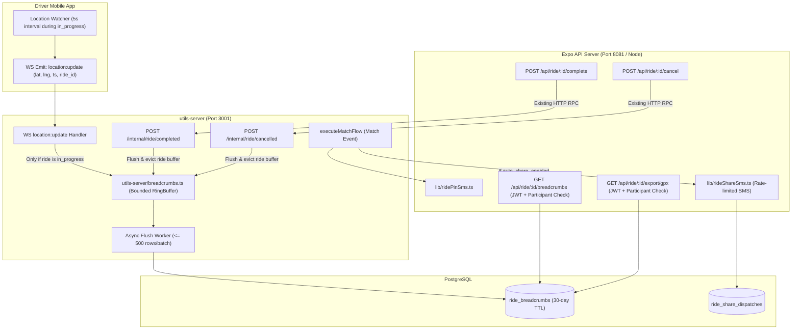

# Plan 28 (v2.1) — Live Ride Sharing & In-Progress Breadcrumb Engine

> **Document Status:** VERIFIED & HARDENED (EGM Goldfish Review Approved with Amendments)  
> **Replaces:** Plan 28 v1.0 (Rejected)  
> **Target Release:** Safety & Telematics Phase  
> **Core Invariants Preserved:**
> 1. **P1-17 (Terminal Privacy Unbroken):** Zero public post-trip coordinate exposure. Route replay & GPX export are strictly authenticated, participant-only (`isParticipant` via `lib/rideParticipants.ts` or admin) and in-app only.
> 2. **Auto-Share v1 is SMS-Only:** Triggered exclusively at match time in `executeMatchFlow` alongside `sendMatchPinSms`. Server-side WhatsApp is dropped (client 1-tap user tap only).
> 3. **Dedicated In-Progress Telematics Module (`utils-server/breadcrumbs.ts`):** Uncoupled from `utils-server/trace.ts` (which is pickup-only and deleted at trip start). Captures `in_progress` only; bounded memory cap; flushed on existing `/internal/ride/completed` and `/internal/ride/cancelled`.
> 4. **No Phantom Fields:** WS ingestion uses existing `LocationUpdateMessage` (`lat`, `lng`, `ts`, `ride_id`). Speed is derived on query ($\Delta d / \Delta t$), preserving the WS contract.
> 5. **Zero Client/Server Bleed:** Client mobile code never imports server-only secret modules (`lib/dprelay.ts`). Android package pinned to `com.ride.bd`.

---

## 1. Architect Rulings Ledger

| Ruling | Decision | Implementation Rule |
|---|---|---|
| **R-1: Terminal Privacy** | P1-17 remains strictly intact. No public post-completion route or coordinate access under any circumstance. | Public `/track/[id]` degrades to status-only with nulled coordinates upon completion. Route replay & GPX export live exclusively inside the authenticated mobile app under strict participant ownership. |
| **R-2: Auto-Share Channel** | Auto-share v1 is SMS-only. Server-side WhatsApp is dropped. | In-app 1-tap WhatsApp sharing remains client-driven via native deep link. Automated background dispatches use `lib/rideShareSms.ts` via dpRelay. |
| **R-3: Auto-Share Trigger Site** | Trigger at ride MATCH, not completion or request. | Located directly in `executeMatchFlow` ([`utils-server/index.ts` #L2632](file:///d:/My%20Projects/Current%20Project/Ride/utils-server/index.ts#L2632)) adjacent to `sendMatchPinSms`. |
| **R-4: Telematics Scope** | Breadcrumbs record `in_progress` only. Accept-to-start (pickup) is excluded. | Protects driver pre-pickup privacy. Recording begins at `ride:start` and terminates at `ride:completed` / `ride:cancelled`. |
| **R-5: Buffer Architecture** | Dedicated `utils-server/breadcrumbs.ts` ring buffer. Zero dependence on `trace.ts`. | Keyed by `ride_id`, capped at 720 points per ride (1 hour at 5s), flushed in batches of $\le 500$ rows to Postgres, with immediate flush on internal completion/cancellation endpoints. |
| **R-6: Retention & Purge** | Day-one 30-day retention policy via Scheduler Job 61. | Partitioned or indexed by `recorded_at`, purged via daily scheduler job. |

---

## 2. System Architecture & Lifecycle Hooks



---

## 3. Database Schema & Migration (`0088`)

### 3.1 Migration File: `src/db/migrations/0088_ride_auto_share_and_breadcrumbs.sql`
Adheres strictly to the `--> statement-breakpoint` convention:

```sql
-- 1. Rider auto-share settings
ALTER TABLE "users" 
ADD COLUMN IF NOT EXISTS "auto_share_rides_enabled" boolean NOT NULL DEFAULT false;
--> statement-breakpoint

-- 2. Emergency contact auto-share flag (MUST default to false for explicit consent)
ALTER TABLE "user_emergency_contacts"
ADD COLUMN IF NOT EXISTS "auto_share_enabled" boolean NOT NULL DEFAULT false,
ADD COLUMN IF NOT EXISTS "is_verified" boolean NOT NULL DEFAULT false;
--> statement-breakpoint

-- 3. In-progress breadcrumbs table
CREATE TABLE IF NOT EXISTS "ride_breadcrumbs" (
  "id" bigint GENERATED ALWAYS AS IDENTITY PRIMARY KEY,
  "ride_id" uuid NOT NULL REFERENCES "rides"("id") ON DELETE CASCADE,
  "latitude" numeric(10, 7) NOT NULL,
  "longitude" numeric(10, 7) NOT NULL,
  "recorded_at" timestamptz NOT NULL,
  "created_at" timestamptz NOT NULL DEFAULT now()
);
--> statement-breakpoint

CREATE INDEX IF NOT EXISTS "ride_breadcrumbs_ride_seq_idx" 
ON "ride_breadcrumbs" ("ride_id", "recorded_at" ASC);
--> statement-breakpoint

CREATE INDEX IF NOT EXISTS "ride_breadcrumbs_recorded_at_idx" 
ON "ride_breadcrumbs" ("recorded_at");
--> statement-breakpoint

-- 4. Audit ledger for auto-shared SMS dispatches
CREATE TABLE IF NOT EXISTS "ride_share_dispatches" (
  "id" uuid PRIMARY KEY DEFAULT gen_random_uuid(),
  "ride_id" uuid NOT NULL REFERENCES "rides"("id") ON DELETE CASCADE,
  "recipient_phone" varchar(20) NOT NULL,
  "recipient_name" varchar(100),
  "dispatch_status" varchar(20) NOT NULL, -- 'sent' | 'failed' | 'rate_limited'
  "sent_at" timestamptz NOT NULL DEFAULT now(),
  "error_message" text
);
--> statement-breakpoint

CREATE INDEX IF NOT EXISTS "ride_share_dispatches_ride_idx" 
ON "ride_share_dispatches" ("ride_id");
```

### 3.2 Drizzle Schema Additions (`src/db/schema.ts`)
```typescript
// 1. Update users table:
auto_share_rides_enabled: boolean("auto_share_rides_enabled").notNull().default(false),

// 2. Update userEmergencyContacts table:
auto_share_enabled: boolean("auto_share_enabled").notNull().default(false),
is_verified: boolean("is_verified").notNull().default(false),

// 3. New rideBreadcrumbs table:
export const rideBreadcrumbs = pgTable(
  "ride_breadcrumbs",
  {
    // Mode 'number' prevents JavaScript BigInt primitive serialization crash in Response.json()
    id: bigint("id", { mode: "number" }).generatedAlwaysAsIdentity().primaryKey(),
    ride_id: uuid("ride_id")
      .notNull()
      .references(() => rides.id, { onDelete: "cascade" }),
    latitude: numeric("latitude", { precision: 10, scale: 7 }).notNull(),
    longitude: numeric("longitude", { precision: 10, scale: 7 }).notNull(),
    recorded_at: timestamptz("recorded_at").notNull(),
    created_at: timestamptz("created_at").notNull().defaultNow(),
  },
  (t) => [
    index("ride_breadcrumbs_ride_seq_idx").on(t.ride_id, t.recorded_at),
    index("ride_breadcrumbs_recorded_at_idx").on(t.recorded_at),
  ]
);

// 4. New rideShareDispatches table:
export const rideShareDispatches = pgTable(
  "ride_share_dispatches",
  {
    id: uuid("id").defaultRandom().primaryKey(),
    ride_id: uuid("ride_id")
      .notNull()
      .references(() => rides.id, { onDelete: "cascade" }),
    recipient_phone: varchar("recipient_phone", { length: 20 }).notNull(),
    recipient_name: varchar("recipient_name", { length: 100 }),
    dispatch_status: varchar("dispatch_status", { length: 20 }).notNull(),
    sent_at: timestamptz("sent_at").notNull().defaultNow(),
    error_message: text("error_message"),
  },
  (t) => [
    index("ride_share_dispatches_ride_idx").on(t.ride_id),
  ]
);
```

---

## 4. Telematics & Buffer Ingestion (`utils-server/breadcrumbs.ts`)

### 4.1 Memory Bounds & Ingestion Logic
To prevent connection starvation on the shared 5-connection pool:
1. **Module Design:** `utils-server/breadcrumbs.ts` is completely separate from `utils-server/trace.ts`.
2. **Buffer Limits:**
   * Keyed by `ride_id`.
   * Ring buffer capped at **720 points per ride** (1 hour at 5s). Once 720 is exceeded, oldest points are dropped or flushed early.
   * Hard global cap: Maximum 100,000 in-memory points across all rides ($\approx 6\text{ MB}$ RAM).
3. **Chunked Database Flushing:**
   * Flushes run periodically every **30 seconds** via a non-blocking worker.
   * Multi-row `INSERT` statements are strictly chunked to **$\le 500$ rows** ($500 \times 4 = 2,000$ bind parameters, well below the Postgres 65,535 ceiling).
   * Timeout of **3,000ms** per insert transaction to prevent pool deadlocks.

### 4.2 Lifecycle Event Triggers
1. **Ride Start (`ride:started` and WS `ride:start`):**
   * Initializes the breadcrumb buffer for `ride_id`. Triggered both via the WebSocket handler in `utils-server/index.ts` (#L1800-1832) and the HTTP endpoint `POST /internal/ride/started` (#L904-936).
2. **Ride Completion / Cancellation (`/internal/ride/completed` and `/internal/ride/cancelled`):**
   * Existing endpoints in `utils-server/index.ts` call:
     ```typescript
     await flushAndEvictBreadcrumbs(ride_id);
     ```
   * Flushes all remaining in-memory points immediately to Postgres and removes the `ride_id` from memory. Even if an active ride ends abruptly in a cancel or incident, **no breadcrumbs are lost or leaked**.

---

## 5. Security & Privacy Architecture (P1-17 Unbroken)

### 5.1 Public Tracking URL (`/track/[rideId]`)
* **Strict Invariant P1-17 Enforcement:**
  * **While Ride is Active:** Returns live pickup/destination coordinates, driver name, vehicle model, and plate number.
  * **When Ride is Terminal (`completed`, `cancelled`, `expired`):** Coordinates and driver details are **immediately nulled**. Response returns status only with `Cache-Control: no-store` and `X-Robots-Tag: noindex`.
  * Public track endpoint **NEVER** serves breadcrumb arrays, GPX downloads, or post-trip replay scrubber data.

### 5.2 Authenticated Route Replay & GPX Export (In-App Only)
Route scrubber replay and GPX download are **strictly in-app, authenticated features** gated against IDOR vulnerabilities using the canonical participant helper:

#### Endpoint 1: `GET /api/ride/[id]/breadcrumbs`
* **Authentication:** Requires valid Supabase JWT (`verifySupabaseToken(request)`).
* **Participant Authorization Guard (`lib/rideParticipants.ts`):**
  ```typescript
  import { resolveRideParticipantIds, isParticipant } from "@/lib/rideParticipants";

  const [ride] = await db.select({
    id: rides.id,
    user_id: rides.user_id,
    driver_id: rides.driver_id,
  }).from(rides).where(eq(rides.id, id)).limit(1);

  if (!ride) return Response.json({ error: "not_found" }, { status: 404 });

  // Canonical resolution: resolves drivers.id -> users.id to prevent false 403s on drivers
  const participantIds = await resolveRideParticipantIds(db, ride);
  const isAuthorized = isParticipant(participantIds, user.id) || user.role === "admin";
  if (!isAuthorized) {
    return Response.json({ error: "forbidden", message: "Access denied" }, { status: 403 });
  }
  ```
* Returns JSON coordinate array with calculated speed:
  ```json
  {
    "ride_id": "...",
    "points": [
      { "lat": 23.7925, "lng": 90.4078, "t": "2026-11-01T18:00:05Z", "speed_kmh": 22.4 }
    ]
  }
  ```

#### Endpoint 2: `GET /api/ride/[id]/export/gpx`
* **Authentication:** Same canonical `resolveRideParticipantIds` authorization guard as above.
* **Format:** Clean standard GPX 1.1 XML stream (`application/gpx+xml`).
* **Sanitization:** All metadata text (ride ID, vehicle type) is XML-escaped; zero unescaped user-input strings are embedded.

---

## 6. Auto-Share Engine (`lib/rideShareSms.ts`)

### 6.1 Match-Time Trigger
Triggered at match time in [`utils-server/index.ts` line 2632](file:///d:/My%20Projects/Current%20Project/Ride/utils-server/index.ts#L2632) directly adjacent to `sendMatchPinSms`:

```typescript
// executeMatchFlow in utils-server/index.ts
import("../lib/rideShareSms")
  .then(({ sendMatchAutoShareSms }) => sendMatchAutoShareSms(db, { ride_id: rideId, rider_user_id: ride.user_id }))
  .catch((err) => logger.warn("[autoShare] match SMS trigger failed (non-blocking)", err));
```

### 6.2 Rate Limits & Cost Controls
* Follows the exact pattern of `lib/ridePinSms.ts` with injected sender:
  * Reads rider's `user_emergency_contacts` where `auto_share_enabled = true AND is_verified = true`.
  * **Per-Trip Cap:** Maximum **2 contacts** per ride.
  * **Daily Cap:** Maximum **6 auto-share SMS messages** per rider per 24-hour rolling window.
  * **Message Content:**
    > *"Ride Alert: [Rider] is on a trip with Ride (Plate: [Plate]). Track live: https://ride.com.bd/track/[ride_id]"*
  * Non-blocking fire-and-forget: SMS gateway errors are logged to `ride_share_dispatches` with status `'failed'` and **never block ride matching**.

---

## 7. Mobile Client & Deep Linking (React Native)

### 7.1 Android & iOS Manifest Configuration
Manifest queries must be declared via `expo-build-properties` to resolve WhatsApp on Android 11+ (API 30+).

Prerequisite: `npm install expo-build-properties` in root package.

In `app.config.js`:
```javascript
plugins: [
  [
    "expo-build-properties",
    {
      android: {
        manifestQueries: {
          package: [
            "com.whatsapp",
            "com.whatsapp.w4b"
          ]
        }
      },
      ios: {
        infoPlist: {
          LSApplicationQueriesSchemes: ["whatsapp"]
        }
      }
    }
  ]
]
```

### 7.2 Safe Client-Side Phone Normalization
To prevent importing server-side secrets from `lib/dprelay.ts` into React Native client bundles, create a pure client helper `lib/clientPhone.ts`:

```typescript
// lib/clientPhone.ts (Client-safe, zero server dependencies)
export function toWhatsAppBdPhone(rawPhone: string): string {
  const digits = rawPhone.replace(/\D/g, "");
  if (digits.startsWith("880")) return digits;
  if (digits.startsWith("0")) return `88${digits}`;
  return `880${digits}`;
}
```

### 7.3 WhatsApp 1-Tap Share in `ride-tracking/[ride_id].tsx`
```typescript
import { Linking, Share } from "react-native";
import { toWhatsAppBdPhone } from "@/lib/clientPhone";

const handleWhatsAppShare = async (rawPhone?: string) => {
  const trackingUrl = `${API_URL}/track/${ride_id}`;
  const message = t("ride_tracking.share_message", { url: trackingUrl });
  const encoded = encodeURIComponent(message);
  const intlPhone = rawPhone ? toWhatsAppBdPhone(rawPhone) : null;

  const appUrl = intlPhone
    ? `whatsapp://send?phone=${intlPhone}&text=${encoded}`
    : `whatsapp://send?text=${encoded}`;
  const webUrl = intlPhone
    ? `https://wa.me/${intlPhone}?text=${encoded}`
    : `https://wa.me/?text=${encoded}`;

  try {
    const canOpen = await Linking.canOpenURL(appUrl);
    if (canOpen) {
      await Linking.openURL(appUrl);
    } else {
      await Linking.openURL(webUrl);
    }
  } catch {
    // Graceful fallback to OS Share Sheet
    await Share.share({ message });
  }
};
```

---

## 8. Data Retention & Purge Job

### 8.1 30-Day Automated Purge (Job 61)
Add Job 61 to `utils-server/scheduler.ts` (Daily at 03:30 UTC):
*(Numbered Job 61 to follow Job 60 Storage Reconciler; avoids collision with Job 38 Dawdle Guard)*

```typescript
// Job 61 — Purge ride breadcrumbs older than 30 days (daily).
async function purgeOldBreadcrumbs(): Promise<void> {
  const cutoff = new Date(Date.now() - 30 * 24 * 60 * 60 * 1000);
  const deleted = await db
    .delete(rideBreadcrumbs)
    .where(lt(rideBreadcrumbs.recorded_at, cutoff));
  logger.info("[scheduler] job 61 purged expired breadcrumbs", { cutoff });
}
```
* **Storage Footprint:**
  * 1,000 rides/day $\times 360$ points/ride $\times 30$ days $\approx 10.8\text{M}$ rows.
  * Bounded at $\approx 850\text{ MB}$ total database storage, preventing runaway disk growth.

---

## 9. Phased Implementation Roadmap & Verification Gates

```
Phase 1: Database Migration 0088 & Drizzle Schema
  ├── Migration 0088 SQL with statement-breakpoints
  ├── Drizzle schema updates in src/db/schema.ts
  └── Gate: npx drizzle-kit generate + npx tsc --noEmit clean

Phase 2: utils-server Telematics Ingestion & Flush Hooks
  ├── Dedicated utils-server/breadcrumbs.ts buffer module (capped at 720 pts/ride)
  ├── WS location:update branch recording during in_progress
  ├── Hook /internal/ride/started, /internal/ride/completed, and /internal/ride/cancelled
  ├── Register Job 61 in utils-server/scheduler.ts
  └── Gate: jest tests for buffer flush, chunking <= 500 rows, and memory caps

Phase 3: Auto-Share Match SMS Engine
  ├── lib/rideShareSms.ts with injected sender & rate limit (max 2/ride, 6/day)
  ├── Hook into utils-server/index.ts executeMatchFlow next to sendMatchPinSms
  └── Gate: Unit tests with mock SMS sender; rate limit boundary assertions

Phase 4: Authenticated In-App Replay & GPX Export API
  ├── GET /api/ride/[id]/breadcrumbs with resolveRideParticipantIds guard
  ├── GET /api/ride/[id]/export/gpx with XML escaping & resolveRideParticipantIds guard
  └── Gate: tests/api/ride/track.test.ts passes unaltered (P1-17 green) + 403 IDOR test

Phase 5: Mobile Client Deep Linking & Settings UI
  ├── Root dependency: npm install expo-build-properties
  ├── Client-safe lib/clientPhone.ts
  ├── WhatsApp 1-tap deep link in ride-tracking/[ride_id].tsx
  ├── Auto-share emergency contacts toggle in settings UI
  └── Gate: expo-build-properties config verified; lint clean
```
