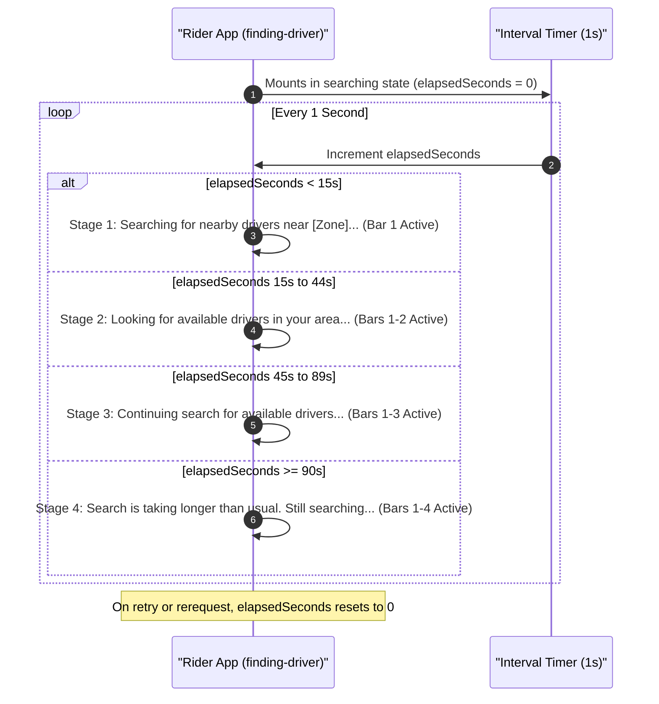
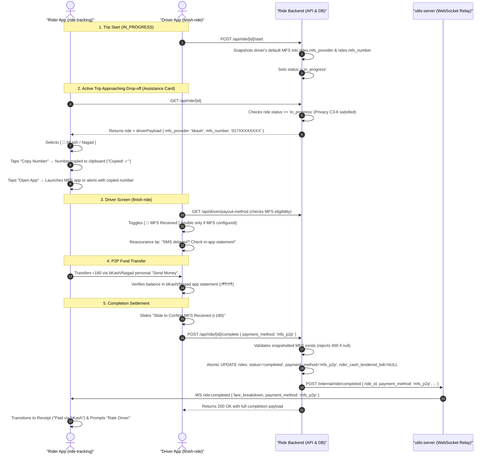

# Plan 29 (v3.1) — Peer-to-Peer MFS Assistance at Drop-Off & Transparent Dispatch Stage Messaging

> **Document Status:** RATIFIED WITH OPEN ITEMS (v3.1 — 2026-11-03)  
> **Replaces:** Plan 29 v3.0, v2.1, & v2.0  
> **Audited By Swarm & Verified Against Live Disk:** `egm-design`, `egm-codebase-details`, `egm-implementation-readiness`, `egm-style`, `egm-zoom-out`  
> **Audited Against (Live Disk):** `src/db/schema.ts`, `app/api/ride/[id]/{index,complete,start,cash-note}+api.ts`, `app/api/driver/payout-method+api.ts`, `utils-server/{types.ts,index.ts}`, `plugins/withMfsPackageQueries.js`, `app.config.js`, `app/(main)/(customer)/finding-driver/index.tsx`, `app/(main)/(customer)/ride-tracking/[ride_id].tsx`, `app/(main)/(rider)/finish-ride/index.tsx`, `app/(main)/(rider)/payout-method/index.tsx`.  
> **Architectural Pillars:** Zero Escrow / Zero Custody (Rule C3-6) · Single Source of Truth (`driverPayoutMethods`) · Trip-Start Wallet Snapshotting (`start+api.ts`) · Zero TOCTOU Fallback · Zero Completed-Cash Privacy Leak · WebSocket Relay Parity (`utils-server`) · Copy Truth Rule Compliance · Native Package Visibility `<queries>` Plugin · Concurrency-Safe Atomic Settlement.  
> **Open Items for Final Closure:**  
> 1. **Native Device Verification of Deep-Link Schemes:** Requires clean native build (`npx expo run:android`) and physical device verification with consumer bKash & Nagad apps installed to verify whether `bkash://` and `nagad://` URI schemes exist/respond on device (or if UX relies strictly on 1-Tap Copy Number fallback).  
> 2. **Advisory Lock Concurrency Lane Execution:** `npm run test:concurrency` execution deferred pending disposable `SCRATCH_DATABASE_URL` provisioning via `node scripts/concurrency-scratch-project.mjs`.
> 3. **Stage Thresholds (FLAW 5) — CLOSED by Ruling 1:** Fixed thresholds (0–15s, 15–45s, 45–90s, 90s+) with rider wait-time copy. NOT coupled to `dispatch_offer_ttl_seconds`: drivers reject in 1–3s, so the server advances candidates long before the TTL, and the timer measures rider wait time, not server ticks.
> 4. **Settlement Method Mismatch (FLAW 7) — CLOSED by Ruling 2:** The Driver's slide confirmation is authoritative. The rider's Cash/MFS choice (`ride-tracking/[ride_id].tsx` ~92) is an informative local assistance card only. The ride is never locked or disputed at drop-off (avoids curbside deadlock); post-trip disputes go through `/api/support`.
> 5. **Gate-8 Test File Ownership (FLAW 12) — CLOSED by Ruling 3:** `tests/api/ride/complete-mfs.test.ts` → Stage 1 (Backend API Engine, `app/api/ride/[id]/`); `utils-server/__tests__/ws-contract-sync.test.ts` → Stage 2 (Dispatch Engine, `utils-server/`); `app/__tests__/screens/finding-driver.test.ts` → Stage 3 (Rider Mobile Client, `app/(main)/(customer)/finding-driver/`).

---

> [!IMPORTANT]
> **GlideX Directory Layout Convention Notice:**  
> The codebase follows legacy GlideX route group naming:  
> - `app/(main)/(customer)/` houses **Rider** screens (`finding-driver`, `ride-tracking`).  
> - `app/(main)/(rider)/` houses **Driver** screens (`finish-ride`, `payout-method`, `driver-home`).  
> In all documentation and specifications, entity roles are strictly **Rider** and **Driver** (informal terms like "passenger" are eliminated).

---

## 1. Problem Statement & Business Motivation

In Bangladesh's ride-hailing and lead-generation ecosystem, passenger and driver friction concentrates heavily at two distinct phases:

### Phase 1: Dispatch Opacity (`finding-driver/index.tsx`)
* **The Problem:** Sequential dispatch evaluates drivers in 15-second individual offer windows. On the Rider's phone, however, the UI renders an identical, static pulsing radar with generic text (`"Searching nearby drivers..."`).
* **Consequence:** Riders receive zero feedback regarding system activity. After 20–30 seconds of perceived unresponsiveness, riders assume the request is stuck or that no drivers exist, cancelling prematurely.
* **The Copy Truth Invariant (Owner Ruling 2026-08-28):** The dispatch engine uses a fixed H3 k=60 ring (~19km) from $t=0$ and sequential driver offers. UI messaging must never claim corridor widening, plural simultaneous offers, or fictitious "high demand" based merely on an elapsed timer. Pacing copy must truthfully reflect general search progression, and timer state must strictly reset to 0 upon retry or re-request.

### Phase 2: Drop-Off Fare Settlement Friction (`ride-tracking/[ride_id].tsx` & `finish-ride/index.tsx`)
* **The Problem:** Riders frequently lack exact physical cash (e.g. needing change for a 1,000 BDT note on a 180 BDT trip). Riders negotiate to pay via personal mobile financial services (MFS: bKash or Nagad).
* **The Real-World Field Friction:**
  1. The driver recites an 11-digit mobile number aloud amid loud traffic noise.
  2. The rider manually types the number into their MFS app, reads it back to confirm the driver's name, enters the fare, and inputs their PIN.
  3. A single mistyped digit transfers real money to an unintended stranger, causing immediate distress.
  4. Both parties wait 30–90 seconds blocking roadside traffic for carrier SMS confirmation (frequently delayed during evening peak hours).
* **The Core Invariant (Zero Escrow / Zero Custody):** Ride operates strictly as a lead distribution network on driver subscriptions with 0% commission. The platform **never handles, routes, or holds** passenger fare money. Digital fare settlement must be strictly **peer-to-peer (P2P)** between the rider's personal wallet and the driver's personal wallet, requiring zero merchant payment gateway processing fees or platform escrow liability.

---

## 2. Comprehensive Flaw Audit & Resolution Matrix (v3.1)

Every flaw identified across audits and live disk inspections has been comprehensively documented and resolved:

| ID | Category | Flaw Description | Root Cause | Resolution in v3.1 |
|---|---|---|---|---|
| **FLAW 1** | Critical | Timer did not reset on search retry | `rerequestRide` and retry buttons in `finding-driver/index.tsx` never called `setElapsedSeconds(0)`. | Added `setElapsedSeconds(0)` to `rerequestRide`, both retry button handlers, and `useEffect([findingState])`. |
| **FLAW 2** | Critical | Driver MFS leaked on completed cash rides | `index+api.ts` gated only on `in_progress \|\| completed` without checking `payment_method`, leaking personal numbers on completed cash rides. | Gated `index+api.ts` strictly to `in_progress || (completed && payment_method === 'mfs_p2p')`. Completed cash rides return `null`. |
| **FLAW 3** | High | Concurrency lane skipped in validation gates | Plan §7 omitted `npm run test:concurrency` despite modifying money-critical completion settlement and schema. | Added Concurrency Lane Gate to §7 with explicit `SCRATCH_DATABASE_URL` prerequisite and execution protocol. |
| **FLAW 4** | High | Unverified deep-link schemes & missing native rebuild | `bkash://` and `nagad://` custom URL schemes are unverified vendor schemes; `<queries>` requires `npx expo run:android`. | Demoted status to `RATIFIED WITH OPEN ITEMS`, added native rebuild instruction, and documented copy-fallback reality. |
| **FLAW 5** | Medium | Stage boundaries hard-coded to 15s offer TTL | Stage copy claimed "expanding offers" at 15s even if `dispatch_offer_ttl_seconds` is configured to 25s in `platform_config`. | **CLOSED by Ruling 1.** Copy is honest and stage boundaries are fixed (0–15s, 15–45s, 45–90s, 90s+) by design, not coupled to `dispatch_offer_ttl_seconds`. See Open Item 3. |
| **FLAW 6** | Medium | TOCTOU wallet divergence survived in no-snapshot branch | If driver lacked MFS at start, `complete+api.ts` queried live DB at completion, allowing mid-trip wallet switch divergence. | Made trip-start snapshot the **sole** authoritative source of truth. If no snapshot at start, MFS settlement rejects with HTTP 400 `mfs_not_configured`. |
| **FLAW 7** | Medium | Rider settlement toggle is local-only assistance | Plan mermaid depicted bilateral handshake, but rider toggle only reveals card; driver slide confirmation is sole writer. | **CLOSED by Ruling 2.** Rider toggle is local state only (`ride-tracking/[ride_id].tsx` ~92). Driver slide is authoritative. No lock or dispute at drop-off; post-trip disputes go through `/api/support`. See Open Item 4. |
| **FLAW 8** | Medium | Residual Copy Truth nits in stage copy | Stage 1 claimed "nearest available drivers" (plural) in {{zone}} (~19km H3 pool) and Stage 2 claimed corridor widening. | Replaced copy with honest sequential search messages ("Searching for nearby drivers near {{zone}}...", "Looking for available drivers in your area..."). |
| **FLAW 9** | Low | Residue `'rocket'` in schema comment | `src/db/schema.ts:868` comment still read `'bkash' \| 'nagad' \| 'rocket'`. | Cleaned comment to `// 'bkash' \| 'nagad'`. |
| **FLAW 10** | Low | Brittle static string grep in ws-contract test | `ws-contract-sync.test.ts` only did loose `toContain("payment_method,")`. | Updated test to extract the exact `/internal/ride/completed` route block and assert destructuring and `sendToRider` relay. |
| **FLAW 11** | Low | Static package count pinned in gate 6 | §7 gate pinned "(16 safe, 0 risky packages)" instead of checking script exit code. | Updated gate specification to assert exit code 0. |
| **FLAW 12** | Low | Test files unowned & cash-note interplay unspecified | Tests existed on disk but lacked stage attribution; interplay with `cash-note+api.ts` (nulling cash handshake on MFS) was missing. | **CLOSED by Ruling 3.** `cash-note` interplay is documented and test ownership is assigned (see §6 "Test Ownership"). See Open Item 5. |
| **BONUS** | Critical | `finish-ride` omitted `payment_method` in POST body | `finish-ride/index.tsx` neglected to pass `payment_method: settlementMode` in the POST body to `/complete`. | Added `payment_method: settlementMode` to the completion fetch body. |

---

## 3. Goals vs. Non-Goals

### In-Scope Goals
1. **Single Source of Truth Wallet Integration:** Query driver's default active MFS wallet from `driver_payout_methods` table in `app/api/ride/[id]/start+api.ts`, strictly snapshotting `mfs_provider` and `mfs_number` into `rides` on `in_progress` transition.
2. **Strict Privacy Gating (Rule C3-6 & FLAW 2):** Expose `mfs_provider` and `mfs_number` in `app/api/ride/[id]/index+api.ts` **only** during `in_progress` trips OR on `completed` trips settled via `mfs_p2p`. Completed cash rides return strictly `null`.
3. **Rider P2P Transfer Assistance Card:** In `app/(main)/(customer)/ride-tracking/[ride_id].tsx`, allow rider to view driver's snapshotted MFS wallet, with 1-Tap "Copy Number" (`expo-clipboard`) and "Open App" (`Linking.openURL`).
4. **Driver Completion Authoritative Settlement:** In `finish-ride/index.tsx`, driver confirms settlement mode via toggle and slide. POST `/api/ride/[id]/complete` sends `payment_method: settlementMode`, which atomically updates `rides.payment_method` and nulls physical cash handshake fields if `mfs_p2p` was selected.
5. **WebSocket Relay Parity:** Forward `payment_method` through `utils-server/index.ts` on `/internal/ride/completed` so rider client immediately transitions to MFS receipt without default cash fallback.
6. **Transparent Dispatch Stage Progress (`finding-driver/index.tsx`):** Dynamic 4-step progress indicator and truthful sequential queue reassurance copy. The stage thresholds (0–15s, 15–45s, 45–90s, 90s+) are fixed by Ruling 1 and are deliberately not linked to `dispatch_offer_ttl_seconds` (default 15s in `utils-server/index.ts`):
   - **Stage 1 (0–15s):** *"Searching for nearby drivers near {{zone}}..."*
   - **Stage 2 (15–45s):** *"Looking for available drivers in your area..."*
   - **Stage 3 (45–90s):** *"Continuing search for available drivers..."*
   - **Stage 4 (90–120s):** *"Search is taking longer than usual. Still searching..."*
7. **Elapsed Timer Reset on Retry (FLAW 1):** Reset `elapsedSeconds` to 0 upon `rerequestRide` or retry button clicks.

### Out-of-Scope Non-Goals
* **Custom QR Matrix Generator (`lib/qr.ts`):** PRUNED. 1-Tap Copy Number solves user friction with zero math overhead.
* **Platform Escrow or Merchant Checkout:** Strictly prohibited. Ride never routes passenger fare money.
* **Automated Personal MFS Transaction Verification:** Driver verifies receipt directly in their MFS app statement.

---

## 4. System Architecture & Lifecycle Flow

### 4.1 Dispatch Stage Progression (`finding-driver/index.tsx`)

> Thresholds (15/45/90s) are fixed by Ruling 1 and deliberately not linked to `dispatch_offer_ttl_seconds`. See Open Item 3.



### 4.2 Drop-Off P2P MFS Settlement Flow



---

## 5. Database Schema & Migration `0089`

### Clean SQL Migration (`src/db/migrations/0089_p2p_mfs_and_dispatch_messaging.sql`)
```sql
ALTER TABLE "rides"
  ADD COLUMN IF NOT EXISTS "payment_method" varchar(20) DEFAULT 'cash',
  ADD COLUMN IF NOT EXISTS "mfs_provider" varchar(20) DEFAULT NULL,
  ADD COLUMN IF NOT EXISTS "mfs_number" varchar(20) DEFAULT NULL;
```

### Drizzle Schema Integration (`src/db/schema.ts`)
```typescript
payment_method: varchar("payment_method", { length: 20 }).default("cash"), // 'cash' | 'mfs_p2p'
mfs_provider: varchar("mfs_provider", { length: 20 }),                      // 'bkash' | 'nagad'
mfs_number: varchar("mfs_number", { length: 20 }),                          // '01XXXXXXXXX'
```

---

## 6. Implementation Stages & Technical Architecture

### Stage 1: Database Migration & Backend Wallet Lifecycle
* **Primary Code Files:**
  - `src/db/schema.ts`
  - `src/db/migrations/0089_p2p_mfs_and_dispatch_messaging.sql`
  - `src/db/migrations/meta/_journal.json`
  - `app/api/ride/[id]/start+api.ts`
  - `app/api/ride/[id]/index+api.ts`
  - `app/api/ride/[id]/complete+api.ts`
* **Owned Test Files:**
  - `tests/api/ride/complete-mfs.test.ts`
* **Directives & Interplay:**
  1. `start+api.ts`: When transitioning a ride to `in_progress`, query driver's default active MFS payout method (`method_type IN ('bkash', 'nagad')`) and snapshot into `rides.mfs_provider` and `rides.mfs_number`.
  2. `index+api.ts`: Expose `mfs_provider` and `mfs_number` **only** if `ride.status === 'in_progress'` OR (`ride.status === 'completed' && ride.payment_method === 'mfs_p2p'`). Completed cash rides return strictly `null`. Read exclusively from the immutable snapshot.
  3. `complete+api.ts`:
     - If `payment_method === 'mfs_p2p'`, ensure `ride.mfs_provider` and `ride.mfs_number` exist on the ride row; if not, reject with HTTP 400 `{ error: 'mfs_not_configured' }`.
     - Atomically update `rides` with `status = 'completed'`, `payment_method = 'mfs_p2p'`.
     - Nullify `rider_cash_tendered_bdt` and `driver_cash_received_bdt` when settling via MFS (interplay with `cash-note+api.ts` to prevent invalid change-due calculations).
     - Forward `payment_method` in `/internal/ride/completed` broadcast using `Authorization: Bearer ${WEBSOCKET_INTERNAL_SECRET}`.
     - Return full existing completion contract (`ok`, `completed_at`, `fare_breakdown`, `rider_payable_bdt`, `cash_handshake`, etc.).

### Stage 2: `utils-server` WebSocket Relay Contract
* **Primary Code Files:**
  - `utils-server/types.ts`
  - `utils-server/index.ts`
* **Owned Test Files:**
  - `utils-server/__tests__/ws-contract-sync.test.ts`
* **Directives:**
  1. Add `payment_method?: 'cash' | 'mfs_p2p'` to `ride:completed` in `utils-server/types.ts`.
  2. In `utils-server/index.ts`, destructure `payment_method` from `/internal/ride/completed` body and include it in `sendToRider(rider_user_id, { type: 'ride:completed', ..., payment_method })`.
  3. In `ws-contract-sync.test.ts`, extract the route block and assert destructuring and relay order.

### Stage 3: Transparent Dispatch Stage Messaging (`finding-driver/index.tsx`)
* **Primary Code Files:**
  - `app/(main)/(customer)/finding-driver/index.tsx`
  - `i18n/locales/en/common.json` & `i18n/locales/bn/common.json`
* **Owned Test Files:**
  - `app/__tests__/screens/finding-driver.test.ts`
* **Directives:**
  1. Maintain 1-second interval timer during searching state, resetting `elapsedSeconds` to 0 upon retry or re-request (`rerequestRide`).
  2. Strictly adhere to Copy Truth Rule: no fictitious corridor widening, no hardcoded TTL assumptions, no plural connection claims.
  3. Display 4-step animated bar indicator and localized sequential queue text.

### Stage 4: Native Package Visibility & Deep Linking Config
* **Primary Code Files:**
  - `plugins/withMfsPackageQueries.js`
  - `app.config.js`
* **Directives:**
  1. Implement Expo config plugin injecting Android `<queries>` for packages `com.bKash.customerapp`, `com.konasl.nagad` and schemes `bkash`, `nagad`.
  2. Register plugin in `app.config.js` and add `LSApplicationQueriesSchemes` to `ios.infoPlist`.
  3. **Prerequisite:** Changes require native rebuild via `npx expo run:android`.

### Stage 5: Rider Drop-Off P2P MFS Settlement UI (`ride-tracking/[ride_id].tsx`)
* **Primary Code Files:**
  - `app/(main)/(customer)/ride-tracking/[ride_id].tsx`
* **Directives:**
  1. During active trip, render MFS assistance card showing snapshotted provider badge, 11-digit formatted number, 1-tap copy button (`expo-clipboard`), and 1-tap open app button (`Linking.openURL`).
  2. When `ride:completed` arrives with `payment_method === 'mfs_p2p'`, render MFS receipt ("Paid via bKash/Nagad").

### Stage 6: Driver Drop-Off Completion & Eligibility Guard (`finish-ride/index.tsx`)
* **Primary Code Files:**
  - `app/(main)/(rider)/finish-ride/index.tsx`
* **Directives:**
  1. Fetch `/api/driver/payout-method` on screen mount; only render MFS toggle if driver has active MFS configured.
  2. In `handleSlideComplete`, construct `payload = { payment_method: settlementMode, ... }` and transmit in `fetch('/api/ride/[id]/complete')`.
  3. On completion, hide physical cash handshake card if MFS settlement was confirmed.

### Test Ownership (Ruling 3 — Open Item 5)

| Test file | Assigned stage | Subsystem owner | Verification scope |
|---|---|---|---|
| `tests/api/ride/complete-mfs.test.ts` | Stage 1 (Database Migration & Backend Wallet Lifecycle) | Backend API Engine (`app/api/ride/[id]/`) | Trip-start wallet snapshotting (`start+api.ts`); C3-6 privacy gate and completed cash protection (`index+api.ts`); 400 rejection without start snapshot (`complete+api.ts`); nulling cash handshake on MFS settlement |
| `utils-server/__tests__/ws-contract-sync.test.ts` | Stage 2 (utils-server Relay Contract) | Dispatch Engine (`utils-server/`) | `types.ts` wire union (`payment_method?: 'cash' | 'mfs_p2p'`); `/internal/ride/completed` route block and `sendToRider` relay |
| `app/__tests__/screens/finding-driver.test.ts` | Stage 3 (Dispatch Stage Messaging) | Rider Mobile Client (`app/(main)/(customer)/finding-driver/`) | Elapsed duration to 4-stage mapping; boundary coverage (0–14s, 15–44s, 45–89s, 90s+); timer reset on retry and re-request |

---

## 7. Verification Gates & Execution Checklist

Before closing the plan:
1. `node maestro/tools/testid-manifest.cjs` (testID registry freshness).
2. `node maestro/tools/testid-map-freshness.cjs` (attribution verification).
3. `node maestro/tools/testid-flow-currency.cjs` (flow selector currency).
4. `npm run check:fast` (`npm run lint` 0 errors, `npx tsc --noEmit` 0 errors, `npm run check:vacuous` clean).
5. `cd utils-server && npx tsc --noEmit` clean (0 errors).
6. `npm run check:web-imports` (exit code 0; all native imports have web support).
7. `npm run check:i18n-orphans` (exit code 0; 0 missing keys, 0 parity mismatches).
8. Targeted Jest test suite execution:
   `npx jest tests/api/ride/complete-mfs.test.ts app/__tests__/screens/finding-driver.test.ts utils-server/__tests__/ws-contract-sync.test.ts` (all tests passing).
9. **Concurrency Lane Gate (Real Postgres):**
   `npm run test:concurrency` (requires `SCRATCH_DATABASE_URL` from `node scripts/concurrency-scratch-project.mjs`).
10. **Native Device Verification (Physical Hardware):**
    `npx expo run:android` native rebuild; test deep-link behavior on real Android/iOS device with consumer bKash/Nagad apps installed.
