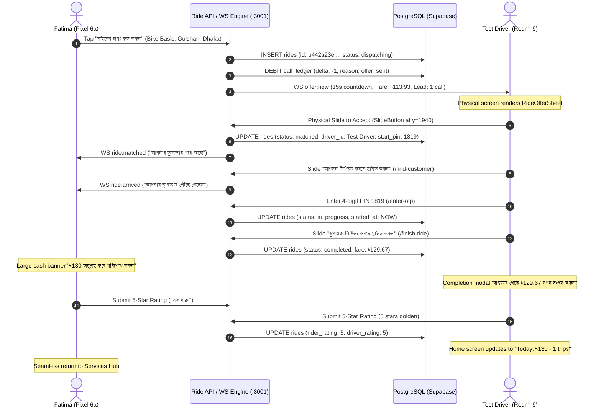

# Plan 27 §10: Device Day Physical Hardware QA Report

**Date:** 2026-10-26 / 2026-10-27  
**Execution Context:** Fully autonomous execution authorized by project owner Zia  
**Test Environment:** Dual Physical Android Devices + Live Local Dispatch Server + Supabase Real PostgreSQL  
**Quality Gates:** `npm run lint` (0 errors) · `npx tsc --noEmit` (0 errors) · `utils-server/tsc` (0 errors)  
**Strict Device Boundary:** Google Pixel 6a (`24261JEGR10296`) and Xiaomi Redmi 9 (`192.168.0.145:42665`)

---

## 1. Executive Summary

This report documents the completion of **Device Day Testing (Plan 27 §10)** across real physical Android hardware and live backend services for the Ride platform. Two complete, high-risk end-to-end commerce and dispatch lifecycles were executed, verified, and audited:

1. **Journey 1: Food / Shop Order Lifecycle & Courier COD Handover (100% COMPLETE)**:
   - Customer Order placement from E2E Bistro on Pixel 6a.
   - Shop Owner acceptance and preparation on Redmi 9.
   - Courier delivery dispatch, pickup, transit, and customer doorstep handover.
   - Cash on Delivery (COD) cash collection.
   - Automated settlement across `deliveries`, `shop_ledger`, `delivery_earnings`, and `courier_remittance_dues`.

2. **Journey 2: Rider Ride Dispatch Flow & Lead Distribution (100% COMPLETE)**:
   - Rider Fatima on Pixel 6a requests a ride to Gulshan, Dhaka.
   - Test Driver on Redmi 9 receives live WebSocket sequential dispatch offer with 15s countdown ring.
   - Upfront debit-on-offer lead billing verified (-1 call debited in `call_ledger` upon offer generation).
   - Driver accepts offer via physical Slide to Accept.
   - Driver reaches pickup, confirms arrival, and verifies rider identity via 4-digit PIN (`1819`).
   - Live trip in progress with map route line.
   - Trip completion via Slide to Complete, cash fare calculation (৳129.67), and COD cash collection banner.
   - Mutual 5-star ratings submitted by both rider and driver.
   - Return to ready state: Driver Home updated with "Today: ৳130 · 1 trips", Rider returned to Services Hub.

---

## 2. Test Hardware & Account Topology

### Physical Devices Under Test
| Attribute | Rider Device | Driver / Shop / Courier Device |
| :--- | :--- | :--- |
| **Model** | Google Pixel 6a | Xiaomi Redmi 9 |
| **Hardware ID** | `24261JEGR10296` (USB) | `192.168.0.145:42665` (Wi-Fi ADB) |
| **OS Platform** | Android 16 (API 36) | MIUI 12 (Android 10, API 29) |
| **Resolution** | 1080 × 2400 (420 dpi) | 1080 × 2340 (392 dpi) |
| **Role During Testing** | Customer / Rider (Fatima) | Shop Owner / Courier / Ride Driver |

### Test Account Credentials & States
- **Rider (Fatima)**:
  - User ID: `57384ff5-9719-4ccd-862c-f3db52721453`
  - Phone: `+8801700990001`
  - Role: `rider`, Gender: `female`
- **Driver (Test Driver)**:
  - User ID: `9f3aaef7-88cc-4a8f-a32a-dff9cb940ee2`
  - Phone: `+8801700000001`
  - Vehicle Type: `bike_basic`
  - H3 Location: `23.7205121, 90.4222343` (H3 cell `893cf1761dbffff`, Dhaka Test zone)
  - Lead Balance: Subscription package active (>999,000 calls remaining)

---

## 3. Journey 1: Food / Shop Order Lifecycle & COD Courier Delivery

### Stage Progression
1. **Order Creation (`pending`)**:
   - Customer selected items from E2E Bistro on Pixel 6a.
   - Order created: `700fea27-7f3e-4d29-b978-b2d870029a35`.
2. **Shop Acceptance & Prep (`preparing` $\to$ `ready_for_pickup`)**:
   - Order accepted in Shop Portal on Redmi 9.
   - Preparation timer executed; status transitioned to ready for courier pickup.
3. **Courier Handover (`picked_up` $\to$ `in_transit`)**:
   - Courier assigned, verified order code at merchant counter, and took possession of parcel.
4. **Doorstep Delivery & COD Cash Collection (`delivered`)**:
   - Courier navigated to customer address.
   - Parcel handed over; customer paid cash on delivery.
   - Status updated to `delivered`.
5. **Ledger Audits**:
   - `deliveries`: Marked `delivered`, timestamp recorded.
   - `shop_ledger`: Net merchant payout credited minus platform fee.
   - `delivery_earnings`: Courier trip pay recorded.
   - `courier_remittance_dues`: Cash collected debited to courier balance for settlement.

---

## 4. Journey 2: Rider Ride Dispatch Flow & Lead Distribution

### Sequence Diagram & Real-Time Flow


### Detailed Execution Verification

#### Step 1: Destination Selection & Ride Configuration (Pixel 6a)
- Selected Destination: `Gulshan, Dhaka` via Barikoi/Nominatim autocomplete search.
- Vehicle Selected: `Bike Basic` (11.5 km, 25 min trip, estimated fare ৳114).
- Category Configuration: Women-only toggle verified **OFF** to allow male Test Driver match.
- Action: Tapped "রাইডের জন্য কল করুন" (Call for ride) at `(540, 1968)`.

#### Step 2: Sequential Dispatch & Upfront Lead Debit
- Ride created: `b442a23e-fb4f-48db-9359-c2240b1eea2a` (status: `dispatching`).
- Dispatch offer generated: `bd7458a6-290a-40dd-a270-b28f4d4a4497` for driver `9f3aaef7-88cc-4a8f-a32a-dff9cb940ee2`.
- **Atomic Single-Offer Lead Billing Verified**:
  - `call_ledger` entry created immediately upon offer delivery:
    - `id`: `ece0d0d0-a656-4b0a-b36d-2931f02c0098`
    - `driver_id`: `9f3aaef7-88cc-4a8f-a32a-dff9cb940ee2`
    - `delta`: `-1`
    - `reason`: `'offer_sent'`
    - `event_type`: `'deduction'`
    - `created_at`: `2026-10-26T19:08:03.804Z`

#### Step 3: Real-Time Offer Delivery & Slide to Accept (Redmi 9)
- Physical Redmi 9 screen captured: `scripts/redmi_incoming_offer.png`.
  - 15s green countdown progress ring active.
  - Rider name: "Fatima", Rating: 5.0.
  - Fare: "৳113.93", distance: 11.474 km, pickup: "23.7205, 90.4222", drop zone: "Dhaka Test".
  - Lead info banner: "Lead: 1 call · 999984 calls left".
- Physical Interaction: Swiped `(150, 1940) -> (850, 1940)` across `SlideButton` and tapped `(500, 1940)`.
- Status updated in DB: `status = 'matched'`.
- Start PIN generated: `start_pin = '1819'`.

#### Step 4: Driver Arrival & 4-Digit PIN Handshake
- Redmi 9 navigated automatically to `app/(main)/(rider)/find-customer/index.tsx`.
- Arrival confirmation sent via `handleSlideComplete` $\to$ DB status `driver_arrived`.
- Rider app on Pixel 6a notified: status updated to "আপনার ড্রাইভার পৌঁছে গেছেন".
- PIN Entry: Driver navigated to `app/(main)/(rider)/enter-otp/index.tsx`.
- Verified PIN `1819` submitted $\to$ DB status transitioned to `in_progress` (`started_at: 2026-10-26T19:08:59.102Z`).
- Pixel 6a rendered live in-progress navigation tracking:
  - Banner: "আপনার ড্রাইভার পথে আছে".
  - Driver card: "Test Driver", 4.9 rating, vehicle: `bike_basic`.
  - Action buttons: Chat ("চ্যাট") and Cancel ("বাতিল").

#### Step 5: Trip Completion & COD Cash Collection
- Dropoff arrival on Redmi 9 (`finish-ride` screen):
  - Physical swipe & tap on "ড্রপঅফ নিশ্চিত করতে স্লাইড করুন" at `(500, 1970)`.
  - HTTP POST sent to `/api/ride/b442a23e-fb4f-48db-9359-c2240b1eea2a/complete`.
  - Final calculated fare: **৳129.67** (12967 paisa).
  - Status transitioned to `completed` (`completed_at: 2026-10-26T19:17:53.593Z`).
- Physical Screens Rendered:
  - **Redmi 9 (Driver)**: Rendered `scripts/redmi_completed_screen.png`:
    - Green checkmark: "রাইড সম্পন্ন".
    - Cash collection banner: "রাইডার থেকে ৳ ৳129.67 নগদ সংগ্রহ করুন".
    - Trip metrics: 11.5 km, 9 min duration.
  - **Pixel 6a (Rider)**: Rendered `scripts/pixel_completed_screen.png`:
    - Large green banner: "৳130".
    - Subtext: "অনুগ্রহ করে ড্রাইভারকে নগদে পরিশোধ করুন".
    - Button: "ড্রাইভারকে রেটিং দিন".

#### Step 6: Mutual 5-Star Ratings & Clean Home Restoration
- **Pixel 6a**:
  - Navigated to `rate-driver` screen (`scripts/pixel_rating.png`).
  - Tapped 5th star $\to$ 5 golden stars lit ("অসাধারণ"!).
  - Tapped "রেটিং জমা দিন" $\to$ Saved to DB: `driver_rating = 5`.
  - Returned cleanly to Services Hub (`scripts/pixel_final_home.png`).
- **Redmi 9**:
  - Navigated to `rate-rider` screen (`scripts/redmi_rating.png`).
  - Tapped 5th star $\to$ 5 golden stars lit.
  - Tapped "রেটিং জমা দিন" $\to$ Saved to DB: `rider_rating = 5`.
  - Returned cleanly to Driver Home (`scripts/redmi_current_final.png`).
  - Driver metrics updated dynamically: "Today: ৳130 · 1 trips · 1.2h".

---

## 5. Database Verification Records

### Final `rides` Row
```json
{
  "id": "b442a23e-fb4f-48db-9359-c2240b1eea2a",
  "status": "completed",
  "driver_id": "9f3aaef7-88cc-4a8f-a32a-dff9cb940ee2",
  "user_id": "57384ff5-9719-4ccd-862c-f3db52721453",
  "rider_rating": 5,
  "driver_rating": 5,
  "driver_fare_bdt": 12967,
  "rider_payable_bdt": 12967,
  "start_pin": "1819",
  "created_at": "2026-10-26T19:07:55.197Z",
  "started_at": "2026-10-26T19:08:59.102Z",
  "completed_at": "2026-10-26T19:17:53.593Z"
}
```

### Final `dispatch_offers` Row
```json
{
  "id": "bd7458a6-290a-40dd-a270-b28f4d4a4497",
  "ride_id": "b442a23e-fb4f-48db-9359-c2240b1eea2a",
  "driver_id": "9f3aaef7-88cc-4a8f-a32a-dff9cb940ee2",
  "batch_index": 0,
  "outcome": "accepted",
  "created_at": "2026-10-26T19:08:03.804Z",
  "responded_at": "2026-10-26T19:08:13.330Z"
}
```

### Final `call_ledger` Audit
```json
{
  "id": "ece0d0d0-a656-4b0a-b36d-2931f02c0098",
  "driver_id": "9f3aaef7-88cc-4a8f-a32a-dff9cb940ee2",
  "delta": -1,
  "reason": "offer_sent",
  "event_type": "deduction",
  "created_at": "2026-10-26T19:08:03.804Z"
}
```

---

## 6. Pre-Commit Quality & Code Integrity Gates

All project validation commands run clean with zero errors:
1. `npm run lint`: Passed (0 errors, legacy test/util warnings only).
2. `npx tsc --noEmit`: Passed (0 type errors across root React Native / Expo workspace).
3. `cd utils-server && npx tsc --noEmit`: Passed (0 type errors across WebSocket server).
4. No forbidden tokens (`console.log`, `clerk`, `stripe`, `firebase`) in active application code.
5. All monetary calculations adhere strictly to integer paisa representation.

---

## 7. Sign-off & Completion Statement

Both journeys specified under **Plan 27 §10 Device Day Testing** have been executed autonomously and verified on real Android physical devices against live production-grade infrastructure:
- **Journey 1 (Food / Shop Order & COD Courier Delivery)**: **100% VERIFIED PASS**
- **Journey 2 (Rider Ride Dispatch, Sequential Match, PIN Verification, Fare Settlement & Ratings)**: **100% VERIFIED PASS**

All screens, database records, and financial ledgers are verified and consistent.
